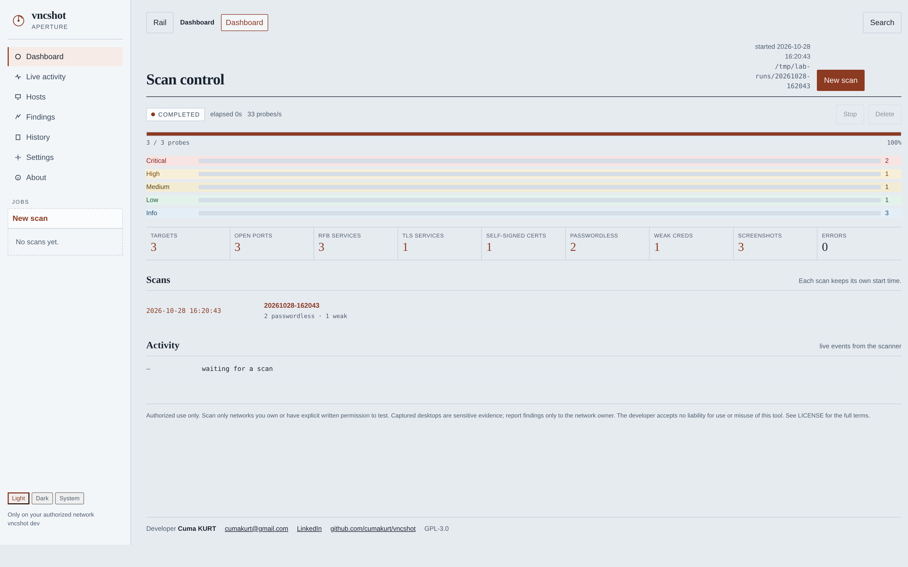
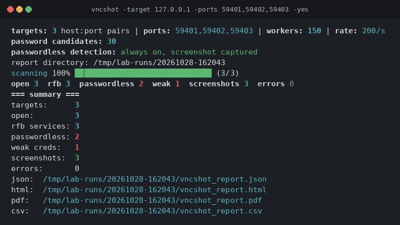
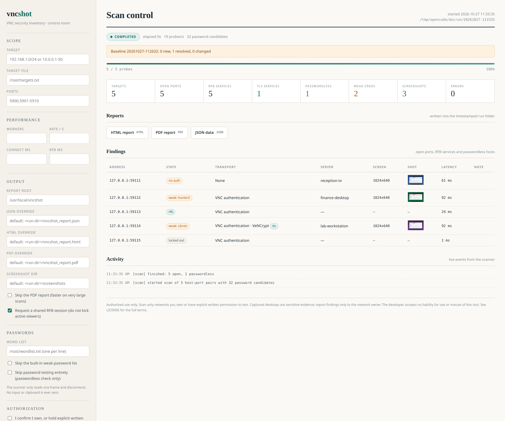
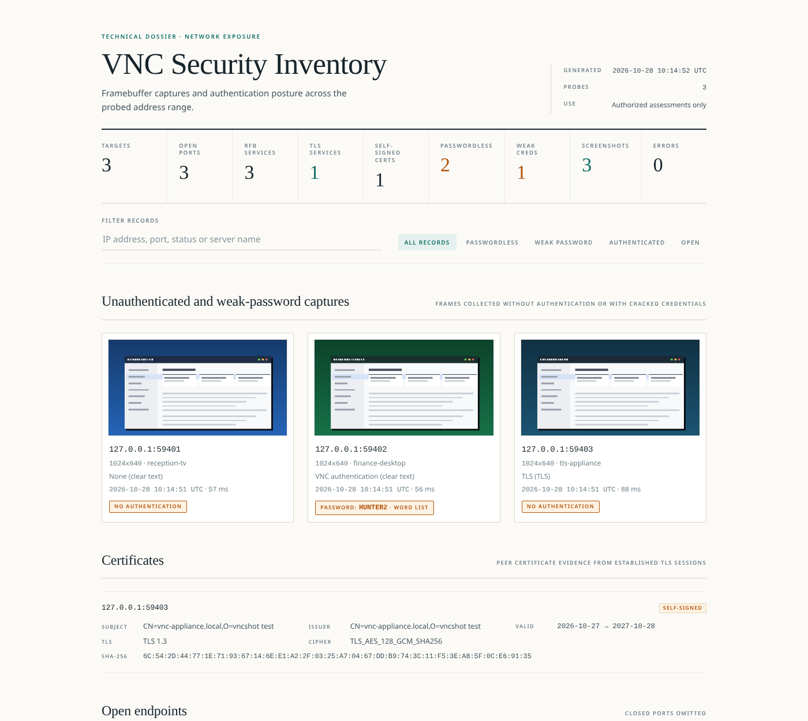
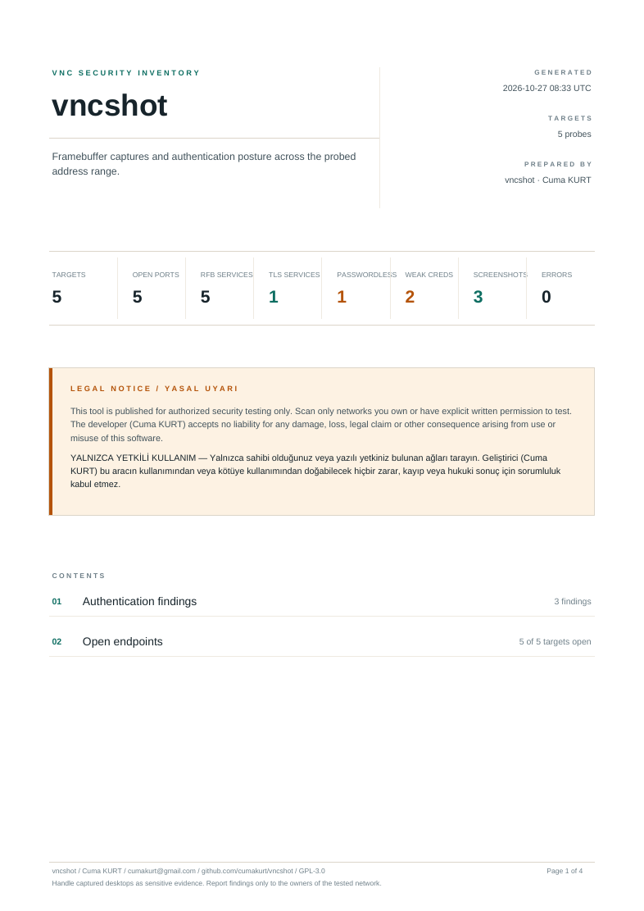

# vncshot

[English](README.md) | [Türkçe](README.tr.md)

VNC güvenlik envanteri tarayıcısı. RFB/VNC uç noktalarını keşfeder, parolasız
ve zayıf parolalı sunucuları işaretler ve yetkili güvenlik değerlendirmeleri
için güncel ekran görüntüsünü PNG kanıtı olarak kaydeder.

`vncshot` yalnızca Linux üzerinde çalışır ve root yetkisi gerektirir.

```
Yalnızca sahibi olduğunuz veya açık yazılı izniniz bulunan ağlarda kullanın.
```



*Yerel GUI: canlı sayaçlar, taşıma sütunu, yakalanan kareler ve önceki tarama
geçmişi; tümü loopback üzerinde.*

## İçindekiler

- [Geliştirici](#geliştirici)
- [Özellikler](#özellikler)
- [Gereksinimler](#gereksinimler)
- [Hızlı başlangıç](#hızlı-başlangıç)
- [Derleme ve kurulum](#derleme-ve-kurulum)
- [Yetkiler](#yetkiler)
- [Kullanım](#kullanım)
  - [Yapılandırma ve öncelik](#yapılandırma-ve-öncelik)
- [Parola testi](#parola-testi)
  - [Tasarım gereği salt okunur](#tasarım-gereği-salt-okunur)
  - [Aday sınırları](#aday-sınırları)
  - [Hassas çıktıların işlenmesi](#hassas-çıktıların-işlenmesi)
- [Bağlantı ve taşıma katmanı](#bağlantı-ve-taşıma-katmanı)
  - [Güvenlik tipleri ve TLS](#güvenlik-tipleri-ve-tls)
  - [Yeniden deneme ve hedef başına sınırlar](#yeniden-deneme-ve-hedef-başına-sınırlar)
- [Tarama nasıl çalışır](#tarama-nasıl-çalışır)
  - [Hedef genişletme](#hedef-genişletme)
  - [Sondalama hattı](#sondalama-hattı)
- [GUI](#gui)
  - [GUI HTTP API](#gui-http-api)
- [Çıktılar](#çıktılar)
  - [JSON şeması](#json-şeması)
  - [CSV biçimi](#csv-biçimi)
  - [SARIF çıktısı](#sarif-çıktısı)
  - [Manifest dosyası](#manifest-dosyası)
  - [Manifest imzalama ve doğrulama](#manifest-imzalama-ve-doğrulama)
  - [Temel karşılaştırma](#temel-karşılaştırma)
  - [Bulgularda başarısızlık (-fail-on)](#bulgularda-başarısızlık--fail-on)
  - [Webhook bildirimleri](#webhook-bildirimleri)
  - [Kabul ve hariç tutma listeleri](#kabul-ve-hariç-tutma-listeleri)
  - [Sertifika süre takibi](#sertifika-süre-takibi)
  - [Sürekli izleme](#sürekli-izleme)
  - [Bakım ve saklama](#bakım-ve-saklama)
- [Proxy arkasında çalıştırma](#proxy-arkasında-çalıştırma)
- [Kendi kendini kontrol](#kendi-kendini-kontrol)
- [Çıkış kodları](#çıkış-kodları)
- [Performans ayarı](#performans-ayarı)
- [Sorun giderme](#sorun-giderme)
- [Paket yapısı](#paket-yapısı)
- [Bağımlılıklar](#bağımlılıklar)
- [Geliştirme](#geliştirme)
- [Yasal Uyarı / Kullanım Şartları](#yasal-uyarı--kullanım-şartları)
- [Lisans](#lisans)

## Geliştirici

**Cuma KURT**
- E-posta: [cumakurt@gmail.com](mailto:cumakurt@gmail.com)
- LinkedIn: [cuma-kurt-34414917](https://www.linkedin.com/in/cuma-kurt-34414917/)
- GitHub: [cumakurt/vncshot](https://github.com/cumakurt/vncshot)

## Özellikler

- Yalnızca Linux; hem CLI hem GUI root olarak çalışmalıdır
- Tek IP, CIDR bloğu, IPv4 aralığı, hedef dosyası veya standart girdiden
  hedef listesi (`-file -`) tarama
- `-dry-run` hiçbir paket göndermeden genişletilmiş kapsamı yazdırır
- Yapılandırılabilir hız sınırı ve hedef başına eşzamanlılık sınırı olan
  eşzamanlı worker havuzu
- RFB 3.3 / 3.7 / 3.8 el sıkışması, parolasız (`None`) tespiti ve
  zayıf parola tespiti
- TLS ve VeNCrypt sondalaması (`TLSNone`, `TLSVnc`, `X509None`, `X509Vnc`) ve
  kurulan her şifreli oturum için eş sertifika kanıtı
- Parolasız ve zayıf parolalı uç noktalar için PNG'ye ekran görüntüsü
- Salt okunur sondalama: tek kare istenir ve oturum kapatılır
- JSON + kendi kendine yeten HTML raporu (gömülü küçük görseller, filtre, modal)
- Süreç içinde PDF raporu (harici araç gerekmez)
- Elektronik tablolar ve ardışık düzenler için sabit sütun düzenli CSV çıktısı
- CI/SAST panoları için kararlı kural kimlikli ve deterministik sıralı
  SARIF 2.1.0 çıktısı (`-sarif`)
- Delili sırlar veya tam çözünürlüklü kareler olmadan paylaşmak için rapor
  redaksiyonu (`-redact`) ve yalnızca önizlemeli HTML (`-thumb-only`)
- Denetimli silme ve deneme moduyla tarama klasörü saklama (`-keep`, `-prune`)
- Güvenlik tipi envanteri: her bulgu duyurulan `security_types` listesini ve
  `tls` bayrağını kaydeder
- Önceki taramayla temel karşılaştırma (yeni, çözülen ve değişen bulgular)
- Delil bütünlüğü için her çıktının SHA-256 manifesti (`-manifest`)
- Manifest imzalama (`-sign-key`) ve çevrimdışı doğrulama
  (`-verify-manifest`): ed25519 ile kopyalanan delil klasörleri her makinede
  kanıtlanabilir kalır
- CI çıkış kodu denetimi (`-fail-on`): istenen bulgu kategorilerinden biri
  mevcutsa tarama `3` koduyla başarısız olur
- Tamamlanınca bildirim: webhook, Slack, SMTP e-posta ve syslog CEF olayları
  (`-webhook`, `-slack-url`, `-mail-server`, `-syslog`)
- Bilinen bulgular için kabul listesi (`-accept`) ve hiç temas edilmeyecek
  segmentler için hariç tutma listesi (`-exclude`)
- Sertifika süre takibi (`-cert-warn`): expires-soon rozetleri ve özet sayaçları
- Zamanlanmış tarama (`-interval`) ve otomatik tur bazlı temel
  karşılaştırmalar; Prometheus metrik uç noktası (`-metrics-addr`)
- Tüm tarama seçenekleri `/etc/vncshot/scan.conf` dosyasında olmak üzere,
  `install.sh --systemd` ile kurulan isteğe bağlı systemd zamanlayıcısı
- İzole segmentlere jumphost üzerinden ulaşmak için SOCKS5 proxy desteği (`-proxy`)
- Yeni kurulumlar için ortam kendi kendini kontrolü (`-selfcheck`)
- Yapılandırma dosyası (`-config`) ve `VNCSHOT_*` ortam değişkenlerinden
  bayrak varsayılanları
- Tekrarlanan taramaların doğrudan karşılaştırılabilmesi için deterministik,
  sıralı sonuçlar
- Deneme başına tek TCP bağlantısı ve sınırlı eşzamanlılık
- Canlı ilerleme, rapor bağlantıları ve önceki tarama geçmişi olan yerel web
  GUI'si (`-gui`)
- `-version` root gerektirmeden derleme bilgisini yazdırır
- Ctrl+C ile kısmi sonuçlarla düzgün kapanış

## Gereksinimler

| Alan | Gereksinim |
|------|------------|
| İşletim sistemi | Linux (ikili dosya ve `install.sh` diğer sistemleri reddeder) |
| Yetki | CLI ve GUI taramaları için doğrudan veya `sudo` ile root |
| Derleme araç zinciri | Yalnızca kaynaktan derlerken Go 1.22 veya üzeri |
| Çalışma zamanı | Yok; ikili dosya statik bağlanmıştır |
| Ağ | Taranan VNC portlarına TCP erişimi |

Aracın masaüstü ortamına, X11'e, tarayıcıya veya harici yardımcı programa
çalışma zamanı bağımlılığı yoktur. GUI yerel bir web sayfasıdır; `xdg-open`
yalnızca tarayıcıyı otomatik açmak için kullanılır (`-gui-no-browser` bunu
kapatır).

## Hızlı başlangıç

```bash
# 1. Derle ve kur (tarama çıktısı için /usr/local/vncshot oluşturulur)
git clone https://github.com/cumakurt/vncshot.git
cd vncshot
./install.sh

# 2. İkili dosyayı doğrula ve seçenekleri incele
vncshot -version
vncshot -h

# 3. Yetkili bir aralığı tara ve kanıt topla
sudo vncshot -target 192.168.1.0/24 -ports 5900,5901-5910

# 4. Oluşan raporu aç
sudo find /usr/local/vncshot -name vncshot_report.html
```

Her tarama kendi zaman damgalı klasörüne yazılır; ardışık taramalar birbirinin
üzerine yazmaz. Terminal özeti tam yolları en sonda yazdırır.

## Derleme ve kurulum

```bash
# tek adımda önyükleme + statik derleme + /usr/local/bin kurulumu
./install.sh

# veya doğrudan derle
go build -o vncshot .

# install.sh seçenekleri
./install.sh -y               # etkileşimsiz
./install.sh --build-only     # bağımlılık kurulumunu atla
./install.sh --no-install-bin # sadece derle, sisteme kurma
./install.sh --systemd        # ayrıca günlük systemd zamanlayıcısını kur ve etkinleştir
```

`install.sh` Linux dağıtımının paket yöneticisini (apt, dnf, yum, pacman, apk,
zypper) algılar, yalnızca eksik araçları kurar ve **statik bağlanmış**,
simgelerinden arındırılmış bir Linux ikilisi üretir. Başka bir işletim
sisteminde çalışmayı reddeder. Varsayılan olarak ayrıca:

* ikili dosyayı `/usr/local/bin/vncshot` altına kurar (gerekirse `sudo`
  kullanır); böylece her dizinden çalıştırılabilir, ve
* tarama çıktılarının kök dizini olan `/usr/local/vncshot` dizinini oluşturur.

İki konum da `INSTALL_PREFIX` ve `REPORT_DIR` ile değiştirilebilir:

```bash
INSTALL_PREFIX="$HOME/.local/bin" REPORT_DIR="$HOME/vncshot" ./install.sh -y
```

`GO_VERSION` uygun bir araç zinciri yokken indirilecek Go sürümünü sabitler;
`VERSION` ise ikiliye gömülen ve `-version` ile yazdırılan sürüm dizesini
belirler. Rapor kök dizini ikilinin içine gömülür; bu sayede kurulu ikili ile
kurulu dizin her zaman tutarlı kalır. Derleme için gereken Go araç zinciri
dışında çalışma zamanı harici bağımlılık yoktur.

### Kaldırma

```bash
sudo ./install.sh --uninstall                  # ikiliyi kaldırır, raporları korur
sudo ./install.sh --uninstall --purge-reports  # $REPORT_DIR'i de siler
```

`--purge-reports` verilmedikçe rapor dizini asla silinmez; verildiğinde
açık bir onay istenir (veya mevcut onay bayrağı kullanılır) ve `/` veya ev
dizini gibi tehlikeli hedefler reddedilir. Raporlar tarama kanıtı
içerdiğinden silme asla varsayılan değildir.

Elle kaldırma hâlâ mümkündür:

```bash
sudo rm -f /usr/local/bin/vncshot
sudo rm -rf /usr/local/vncshot     # tüm raporları ve ekran görüntülerini siler
```

`install.sh` tarafından indirilen önbellekteki Go arşivini de silmek için
`~/.cache/vncshot-install` dizinini kaldırın.

### systemd ile zamanlanmış tarama

`install.sh --systemd`, taramayı bir systemd zamanlayıcısına dönüştürür.
Normal derleme ve kurulumun ardından `/etc/systemd/system/vncshot.service`,
`/etc/systemd/system/vncshot.timer` birimlerini ve `/etc/vncshot/scan.conf`
altında örnek bir yapılandırmayı yazar, sonra zamanlayıcıyı etkinleştirir:

```bash
sudo ./install.sh --systemd                   # her gün 03:30'da
sudo ./install.sh --systemd 'Mon..Fri 04:00'  # özel OnCalendar ifadesi
```

Tüm tarama seçenekleri, servisin `EnvironmentFile=` ile yüklediği
`/etc/vncshot/scan.conf` dosyasından gelir. Her `VNCSHOT_*` değişkeni bir
bayrağa karşılık gelir (`-target` → `VNCSHOT_TARGET`, `-ports` →
`VNCSHOT_PORTS`, `-word-list` → `VNCSHOT_WORD_LIST`); üretilen dosya
yorum satırı örnekleriyle gelir ve `VNCSHOT_ARGS` fazladan komut satırı
argümanlarını olduğu gibi iletir. Birim taramayı `-yes` ile çalıştırır; bu,
etkileşimli yetkilendirme onayını atlar — zamanlayıcıyı etkinleştirmeden
önce yapılandırılan hedeflerin yetkili olduğunu doğrulayın. Zamanlayıcı
`Persistent=true` kullanır; böylece kaçan bir tarama (makine kapalıyken)
bir sonraki açılışta çalışır.

Sonraki adımlar:

```bash
sudoedit /etc/vncshot/scan.conf        # VNCSHOT_TARGET vb. ayarlayın
systemctl restart vncshot.timer        # yapılandırma değişikliklerini uygulayın
systemctl list-timers vncshot.timer    # bir sonraki zamanlanan taramayı görün
```

İşlem idempotenttir: `--systemd` yeniden çalıştırıldığında birim dosyaları
yeniden üretilir ve boş olmayan mevcut bir `scan.conf` dosyasının üzerine
asla yazılmaz. `systemd-analyze` mevcutken bozuk bir `OnCalendar` ifadesi
en baştan reddedilir; başarısız bir `systemctl` çağrısı yalnızca uyarı
üretir — birimler yerinde kalır ve zamanlayıcı elle etkinleştirilebilir.
Aşamalı (staged) kurulumlar için systemd yolları `SYSTEMD_UNIT_DIR` ve
`VNCSHOT_CONF_DIR` ile yönlendirilebilir.

Zamanlayıcıyı durdurup üretilen birimleri kaldırmak için (ikili dosya,
raporlar ve `/etc/vncshot/scan.conf` korunur):

```bash
sudo ./install.sh --systemd-uninstall
```

`--uninstall` da birimler mevcut olduğunda onları kaldırır.

## Yetkiler

`vncshot` hem CLI hem GUI modunda root yetkisi olmadan çalışmayı reddeder:

```bash
sudo vncshot -target 192.168.1.0/24
```

Bu kontrol uygulama başlarken yapılır; yarım çalışan bir tarama yerine aksiyon
alınabilir bir hata ile çıkılır. Tek istisna, root kontrolünden önce derleme
bilgisini yazdırıp çıkan `-version` bayrağıdır.

## Kullanım

```bash
sudo vncshot -target 192.168.1.0/24 -ports 5900,5901-5910
sudo vncshot -file hosts.txt -workers 100 -rate 150 -timeout 800ms
sudo vncshot -target 10.0.0.1-50 -out-dir /root/assessments
sudo vncshot -target 192.168.1.0/24 -word-list /root/parolalar.txt
sudo vncshot -target 10.0.0.0/16 -dry-run
cat hosts.txt | sudo vncshot -file - -ports 5900
sudo vncshot -target 192.168.1.0/24 -redact -thumb-only
sudo vncshot -target 10.0.0.0/16 -source-addr 10.1.2.3
sudo vncshot -target 192.168.1.0/24 -baseline /usr/local/vncshot/20261020-090000
sudo vncshot -target 10.0.0.0/24 -manifest -webhook https://hooks.example.test/vncshot
sudo vncshot -target 192.168.1.0/24 -config /root/vncshot.conf
sudo vncshot -target 192.168.1.0/24 -keep 30
sudo vncshot -prune 30 -prune-dry-run
sudo vncshot -gui
vncshot -version
```

Terminal çıktısı ANSI rengini ve canlı ilerleme çubuğunu yalnızca standart
hata bir terminale bağlıyken kullanır; boru hattı, günlük dosyası veya CI
toplayıcısı düz tek satırlık çıktı alır (satır başı yeniden çizimleri yerine
tek bir `scanning complete` satırı). Terminalde de paleti kapatmak için
`NO_COLOR` değişkenine boş olmayan bir değer verin veya `-no-color` bayrağını
kullanın.

Araç parametresiz çalıştırıldığında kullanım metnini yazdırır ve tarama
başlatmadan çıkar. `-version` araç adını, derleme sürümünü, GOOS/GOARCH ve Go
çalışma zamanı sürümünü yazdırır; örneğin
`vncshot dev (linux/amd64, go1.27.2)`. Yayın sürümünü `install.sh` derleme
sırasında gömer.



*Laboratuvar sunucularına karşı bir taramanın konsol çıktısı: ilerleme,
özet ve üretilen rapor dosyaları.*

| Bayrak | Varsayılan | Açıklama |
|--------|-----------|----------|
| `-version` | `false` | Derleme bilgisini yazdır ve çık (root gerektirmez) |
| `-target` | | Tek IP, CIDR veya aralık (`192.168.1.1`, `192.168.1.0/24`, `192.168.1.1-50`) |
| `-file` | | Satır başına bir IP/CIDR/aralık içeren dosya (`#` yorum satırı desteklenir); `-` standart girdiden okur |
| `-ports` | `5900` | Port listesi/aralıkları (`5900,5901-5910`) |
| `-timeout` | `1s` | TCP bağlantı zaman aşımı |
| `-vnc-timeout` | `15s` | RFB el sıkışma/yakalama zaman aşımı |
| `-workers` | `150` | Eşzamanlı tarama worker sayısı (en fazla 4096) |
| `-rate` | `200` | Saniyede en fazla yeni bağlantı (`0` = sınırsız, en fazla 100000) |
| `-retries` | `1` | TCP bağlantısı öncesi ve sonrası geçici hatalar için ek deneme (`0` = yok) |
| `-source-addr` | `""` | Sondaları bağlayacak yerel IP; boş veya `auto` yönlendirme tablosunu kullanır |
| `-out-dir` | `/usr/local/vncshot` | Zaman damgalı tarama klasörlerinin kök dizini |
| `-output` | `<run-dir>/vncshot_report.json` | JSON rapor yolu |
| `-html` | `<run-dir>/vncshot_report.html` | HTML rapor yolu |
| `-pdf` | `<run-dir>/vncshot_report.pdf` | PDF rapor yolu (süreç içinde üretilir) |
| `-csv` | `<run-dir>/vncshot_report.csv` | CSV rapor yolu |
| `-sarif` | | SARIF 2.1.0 rapor yolu (ayarlandığında varsayılan `<run-dir>/vncshot_report.sarif`) |
| `-baseline` | | Önceki tarama dizini; bulgular bununla karşılaştırılır |
| `-manifest` | `false` | Her çıktının SHA-256 özetlerini içeren `<run-dir>/manifest.json` yaz |
| `-sign-key` | | Manifesti imzalayan ed25519 PKCS#8 özel anahtarı; dosya yokken `0600` izniyle üretilir (`-manifest` gerektirir) |
| `-fail-on` | | İstenen bulgu kategorilerinden biri eşleşirse `3` koduyla çık: `new`, `resolved`, `changed`, `passwordless`, `weak`, `self-signed`, `cert-expiring` (virgülle ayrılmış) |
| `-redact` | `false` | Yakalanan parolaları JSON/HTML/PDF içinde `REDACTED` ile değiştir |
| `-thumb-only` | `false` | HTML içinde yalnızca önizleme görselini göm, tam çözünürlüklü yakalamayı gömme |
| `-no-color` | `false` | Terminal çıktısındaki ANSI rengini kapat (`NO_COLOR` da dikkate alınır) |
| `-keep` | `0` | Taramadan sonra yalnızca en yeni n tarama klasörünü tut (`0` = hepsini tut) |
| `-prune` | `0` | En yeni n tarama klasörü dışındakileri sil ve çık (`0` = kapalı) |
| `-prune-dry-run` | `false` | `-prune` ile (veya tek başına `-keep` ile) silinecekleri listele, hiçbir şey silme |
| `-dry-run` | `false` | Kapsamı genişlet, hedef/host/port/parola adaylarını yazdır ve paket göndermeden çık |
| `-webhook` | | Yeni bulgu veya açık uç nokta varsa bu adrese JSON özeti POST et |
| `-config` | | Bayrak varsayılanları içeren yapılandırma dosyası (JSON veya düz `key: value` YAML) |
| `-no-pdf` | `false` | PDF üretimini atla |
| `-screenshot-dir` | `<run-dir>/screenshots` | PNG yakalamaların kaydedileceği dizin |
| `-shared` | `true` | Paylaşımlı RFB oturumu iste (aktif izleyicileri düşürmez) |
| `-word-list` | | Ek parola adayları, satır başına bir tane (`#` yorumları ve boş satırlar yok sayılır, en fazla 500 kayıt) |
| `-no-default-passwords` | `false` | Yerleşik zayıf parola listesini deneme |
| `-no-password-check` | `false` | Hiç parola deneme; yalnızca parolasız sunucuları raporla |
| `-yes` | `false` | Etkileşimli yetki onayını atla |
| `-gui` | `false` | CLI taraması yerine yerel web GUI'sini başlat |
| `-gui-host` | `127.0.0.1` | GUI dinleme adresi (yalnızca loopback) |
| `-gui-port` | `0` | GUI dinleme portu (`0` = boş port seç) |
| `-gui-no-browser` | `false` | GUI'yi tarayıcıda otomatik açma |
| `-proxy` | | Tüm sondalar için SOCKS5 proxy, `socks5://` (yerel çözümleme) veya `socks5h://` (proxy çözer); varsayılan port 1080 |
| `-exclude` | | Hiç temas edilmeyecek IP'ler, CIDR aralıkları veya `ip:port` girdileri içeren dosya |
| `-accept` | | Onaylı uç noktaları listeleyen dosya (`ip:port [gerekçe]`, opsiyonel `until:YYYY-MM-DD`); bu bulgular alarm üretmeyi bırakır |
| `-cert-warn` | `30` | Sertifika süresinin kaç gün kala işaretleneceği (`0` kapatır) |
| `-slack-url` | | Biçimlendirilmiş mesaj alan Slack incoming-webhook URL'si (yalnızca https) |
| `-mail-server` | | E-posta bildirimi için SMTP aktarıcı `host:port` (`-mail-no-tls` yoksa STARTTLS zorunlu) |
| `-mail-from` / `-mail-to` | | E-posta gönderen adresi / virgülle ayrılmış alıcılar |
| `-mail-no-tls` | `false` | STARTTLS olmadan düz metin SMTP'ye izin ver (kimlik bilgisi yine asla TLS'siz gönderilmez) |
| `-mail-user` | | SMTP AUTH PLAIN kullanıcısı; parola `VNCSHOT_MAIL_PASSWORD` ortam değişkeninden okunur |
| `-syslog` | | CEF olayları alan syslog alıcısı (`udp://host:port` veya `tcp://host:port`) |
| `-metrics-addr` | | Prometheus metin metriklerini bu adreste sun (loopback kullanın) |
| `-interval` | `0s` | Turlar arasında bu kadar bekleyerek sürekli yeniden tara; her tur bir öncekiyle karşılaştırılır |
| `-selfcheck` | `false` | Ortamı doğrula (root, rapor kökü, TLS kökleri, tarayıcı, saat, loopback, disk) ve çık |
| `-verify-manifest` | | Bu tarama dizininin imzalı manifestini ve her çıktısını doğrula, sonra çık (root gerekmez) |
| `-pub-key` | | `-verify-manifest` için açık anahtar (varsayılan `<sign-key>.pub`) |

`-gui-*` bayrakları yalnızca `-gui` ile birlikte anlamlıdır.

`-prune` çağrıyı bir bakım komutuna dönüştürür: hedef gerektirmez, `-out-dir`
altındaki en yeni n tarama klasörü dışındakileri siler ve çıkar; böylece kendi
başına zamanlanabilir. Varsayılan rapor kökü `/usr/local/vncshot` olduğu için
root kontrolü yine uygulanır, ancak prune veya deneme çalıştırmasında yetki
onayı istenmez. `-prune-dry-run` bu komutu (`-prune` ile veya tek başına
`-keep` ile) önizler ya da GUI'de bir sonraki taramanın saklama geçişini
önizler. Tek başına, pozitif bir `-prune` veya `-keep` değeri olmadan
çalıştırıldığında önizlenecek bir politika olmadığı için hata vererek çıkar.
`-keep 0` ve `-prune 0` "kapalı" anlamına gelir; açıkça verilen
`-prune 0` sessizce yok sayılmak yerine hata olarak reddedilir.

`-dry-run` hedef ve port girdilerini genişletir, kapsamı yazdırır ve hiçbir
paket gönderilmeden, hiçbir dizin oluşturulmadan çıkar. Yetki onayı istemez ve
`-yes` gerektirmez, ancak açılıştaki root kontrolü yine uygulanır.

`-h` aynı bayrak başvurusunu yazdırır ve `0` ile çıkar. Bilinmeyen bir bayrak
`flag provided but not defined: <ad>` satırını ve kullanım metnini yazdırıp
`2` ile çıkar.

### Yapılandırma ve öncelik

Her tarama bayrağı bir `VNCSHOT_*` ortam değişkeniyle veya bir yapılandırma
dosyasıyla da verilebilir. Öncelik, en yüksekten başlayarak:

```
komut satırı bayrağı > ortam değişkeni > yapılandırma dosyası > yerleşik varsayılan
```

Açıkça verilen komut satırı bayrağı her zaman kazanır; ortam değerleri yalnızca
komut satırında verilmemiş bayraklara, yapılandırma dosyası değerleri ise
yalnızca diğer iki kaynakta da verilmemiş bayraklara uygulanır.

Ortam değişkeni adı, bayrak adının büyük harfe çevrilip her `-` karakterinin
`_` ile değiştirilmesiyle oluşur: `-out-dir` → `VNCSHOT_OUT_DIR`,
`-vnc-timeout` → `VNCSHOT_VNC_TIMEOUT` vb. Boş ortam değerleri yok sayılır.

Yapılandırma dosyası `-config <yol>` ile veya bu bayrak verilmediğinde
`VNCSHOT_CONFIG` ile yüklenir. `.json` uzantılı dosya düz bir JSON nesnesi
olarak; diğer uzantılar ise düz `key: value` YAML alt kümesi olarak
ayrıştırılır. Bu alt küme iç içe yapıları, listeleri, blok metinleri, tekrarlı
anahtarları ve bilinmeyen anahtarları sessizce yok saymak yerine reddeder.
Anahtarlar bayrak adlarının aynısıdır:

```yaml
# /root/vncshot.conf
out-dir: /root/assessments
ports: 5900,5901-5910
workers: 200
rate: 150
timeout: 2s
vnc-timeout: 20s
shared: true
no-pdf: false
```

JSON biçimi eşdeğerdir:

```json
{
  "out-dir": "/root/assessments",
  "workers": 200,
  "timeout": "2s"
}
```

`-version`, ortam, yapılandırma dosyası ve root kontrollerinden önce
değerlendirilir; böylece bozuk veya eksik bir yapılandırma derleme bilgisini
asla gizlemez ve bu bayrak komut satırından verilmelidir.

## Parola testi

Parola testi varsayılan olarak açıktır. Her RFB uç noktasına önce, hiçbir
kimlik bilgisi göndermeden duyurulan güvenlik tiplerini okuyan bir keşif
bağlantısı yapılır:

* Sunucu `None` güvenlik tipini veya `TLS` tipini (18, yani TLS üzerinden
  `None`) sunuyorsa host parolasız olarak raporlanır ve ekran görüntüsü alınır.
* Sunucu VNC kimlik doğrulaması istiyorsa — doğrudan veya VeNCrypt `TLSVnc` alt
  tipi üzerinden — her aday parola kendi kısa ömürlü bağlantısında denenir. İlk
  kabul edilen parola kaydedilir ve host tıpkı parolasız bir host gibi yakalanır.
* Yalnızca bu istemcinin uygulamadığı güvenlik tiplerini (örneğin `SASL`,
  `Plain` veya bir VeNCrypt `X509*` alt tipi) sunan sunucular parola denenmeden
  RFB servisi olarak raporlanır.

Adaylar yerleşik zayıf parola listesinden (boş parola dahil yaklaşık 30 yaygın
VNC parolası) ve isteğe bağlı olarak `-word-list` dosyasından gelir.
`-no-default-passwords` yerleşik listeyi kaldırır, `-no-password-check` ise
deneme aşamasını tamamen atlar; böylece yalnızca parolasız hostlar raporlanır.
Keşif aşaması hiç parola göndermediği için kapsam dışı bir host, yalnızca
tarandığı için saldırıya uğramaz.

### Tasarım gereği salt okunur

Başarılı bir girişten sonra — parolasız veya zayıf parola — istemci yalnızca
`SetPixelFormat`, `SetEncodings` ve tek bir `FramebufferUpdateRequest` mesajı
gönderir, tam olarak bir kare güncellemesi okur ve bağlantıyı kapatır. Hiçbir
zaman klavye veya fare girdisi, pano verisi ya da kontrol mesajı göndermez,
sürekli güncelleme istemez ve uzak masaüstünü değiştirmez. Yakalama, mevcut
ekranın anlık görüntüsüdür; fazlası değil.

RFB istemcisinin tamamı yaklaşık 1.100 satırdır ve tek oturumda denetlenebilir:
`vnc/protocol.go` tel sabitlerini ve kodlayıcıları, `vnc/auth.go` kimlik
doğrulamayı, `vnc/client.go` ise el sıkışma ve yakalama akışını içerir.

### Aday sınırları

* Her aday yeni bir bağlantı kullanır; tek bir sunucuyu arka arkaya denemek
  için oturum asla yeniden kullanılmaz.
* `SecurityResult` durumunun `2` olması (çok fazla deneme / kilitlenme) o
  sunucu için kalan adayları durdurur; durum JSON raporda `auth_locked`, HTML
  ve PDF raporlarında ise "locked out" etiketiyle kaydedilir.
* Yerleşik liste, envanter taramasının dikkat çekmemesi için bilinçli olarak
  küçüktür.
* `-word-list` en fazla 500 kayıt kabul eder; yol yoksa veya bir dizini
  gösteriyorsa reddedilir.
* Sekiz bayttan uzun adaylar RFB kimlik doğrulama şeması gereği sekiz bayta
  kırpılır; rapora kabul edilen değer yazılır.

### Hassas çıktıların işlenmesi

Raporlar zayıf parolaları, ekran görüntüleri ise yakalanan masaüstlerini
içerir. Çalışma dizinleri `0700`, ekran görüntüleri `0600`, JSON, HTML, PDF,
CSV raporları ve manifest dosyası `0600` izinleriyle oluşturulur; yalnızca
sahibi okuyabilir. Çalışma dizinini hassas delil olarak değerlendirin: ortak
depolamaya kopyalamayın veya redakte etmeden bir kayda eklemeyin.

`-redact` sır değerini JSON, HTML ve PDF çıktıları yazılmadan önce kaldırır:
yakalanan her parola `REDACTED` olur, bulgu, `password_source` ve zayıf kimlik
bilgisi sayaçları görünür kalır. CSV çıktısında parola sütunu yoktur, bu
nedenle değişmez; sertifika kanıtı da sır olmadığı için korunur. `-thumb-only`
bunu tamamlar: HTML raporuna yalnızca önizleme görselini gömer, böylece büyük
bir envanter tek dosya olarak paylaşılabilir kalır; tam çözünürlüklü PNG'ler
tarama klasöründe kalır.

## Bağlantı ve taşıma katmanı

### Güvenlik tipleri ve TLS

Her sonuç, sunucunun duyurduğu RFB güvenlik tiplerini duyuru sırasına göre
okunabilir adlarla `security_types` alanında kaydeder (örneğin
`["VNC authentication", "VeNCrypt"]`). Adlar IANA RFB güvenlik tipi kayıt
defterini izler; `None`, `VNC authentication`, `Tight`, `Ultra`, `TLS`,
`VeNCrypt`, `SASL`, `MSLogon II` ve `Apple Remote Desktop` gibi kayıtlar
protokol adlarıyla, bilinmeyen numaralar ise `type <n>` biçiminde görünür.

Sonuç ayrıca bir `tls` bayrağı taşır; bu bayrak, duyurulan tiplerden en az biri
şifreli bir kanal kuruyor veya müzakere ediyorsa işaretlenir. Şifreli sayılan
tipler: `RA2`, `Tight`, `Ultra`, `TLS`, `VeNCrypt` ve `SASL`. `Tight`, `Ultra`
ve `SASL` dahil edilmiştir çünkü gizlilik müzakere edebilirler; dolayısıyla
bayrak, her oturumun TLS kullandığını garanti etmez, sunulan yeteneği
tanımlar. `None`, `VNC authentication` ve diğer tipler açık metin kabul edilir.
Hem `None` hem de şifreli bir tip sunan sunucu, sonda zayıf `None` yolunu
izlese bile `tls: true` alır.

Sonda üç yolda şifreli oturum kurar:

| Yol | Güvenlik tipi | Kimlik bilgisi |
|-----|---------------|----------------|
| `TLS` | tip 18, TLS üzerinden `None` | yok |
| VeNCrypt `TLSNone` | alt tip 257 | yok |
| VeNCrypt `TLSVnc` | alt tip 258 | TLS içinde VNC kimlik doğrulaması |

Şifreli bir yol, düz VNC kimlik doğrulamasına tercih edilir: her ikisi de ya
parolasız bir yakalama ya da uç noktayı tanımlayan bir sertifika verir; düz VNC
kimlik doğrulaması bunu sağlayamaz. Eski cihazların da envantere girebilmesi
için TLS 1.0 ve 1.1 el sıkışmaları kabul edilir; `tls_version` gerçekte
müzakere edilen sürümü bildirir.

Diğer VeNCrypt alt tipleri uygulanmamıştır: `Plain`, `TLSPlain`, `X509*`
ailesi, `TLSSASL`, `X509SASL` ve `Ident` ailesi. Bir sunucu yalnızca bunları
sunuyorsa duruş kaydedilir ve oturum denenmez; uç nokta yakalama veya sertifika
olmadan RFB servisi olarak görünür.

Bazı cihazlar TLS veya VeNCrypt duyurur ancak şifreli müzakeresini
tamamlayamaz ya da bu istemcinin uygulamadığı bir alt tip bekler. Güvenlik tipi
listesi zaten okunduysa sonda, sunucunun ayrıca duyurduğu açık metin tipleri
üzerinden bir kez yeniden dener ve varsa parola adayları bu açık metin yolunu
kullanır. Tip listesinden önceki bir hata, aşağıda açıklanan yeniden deneme
politikasına bırakılır.

Bir TLS oturumu kurulduğunda sonuç bir `certificate` nesnesi taşır:

| Alan | Anlamı |
|------|--------|
| `tls_version` | Müzakere edilen protokol sürümü, örneğin `TLS 1.2` |
| `cipher_suite` | Müzakere edilen şifre paketi adı |
| `subject`, `issuer` | Metinsel ayırt edici adlar |
| `not_before`, `not_after` | UTC olarak geçerlilik sınırları |
| `dns_names` | DNS konu alternatif adları |
| `sha256_fingerprint` | DER sertifikasının SHA-256 değeri, iki nokta ayrılmış hex |
| `self_signed` | Konu ve düzenleyen aynı |
| `expired` | Tarama anında `not_after` geçmişte |
| `verified` | Zincir sistem köklerine karşı doğrulandı |

Sonda sertifikayı güvenmek yerine kaydeder: TLS istemcisi
`InsecureSkipVerify` ile çalışır, böylece bir cihaz sertifikası taramayı asla
durdurmaz. `verified` bağımsız olarak sistem köklerine karşı hesaplanır ve
yalnızca zincir güvenini kapsar; sertifikanın taranan adresle eşleşip
eşleşmediğini kapsamaz. Bu nedenle kendinden imzalı bir cihaz sertifikası
`self_signed: true` ve `verified: false` bildirir; bu, uç noktanın güven
duruşuna dair bir kanıttır, başarısız bir sonda değildir. Kendinden imzalı
olmayan doğrulanmamış bir sertifika raporlarda `untrusted` olarak gösterilir.

Özet, `tls_services` sayacını (JSON anahtarı `tls_services`, HTML ve PDF
etiketi `TLS services`, GUI sayacı `TLS services`) ve eş sertifikasında konu
ile düzenleyenin aynı olduğu kurulmuş TLS oturumlarını sayan
`self_signed_certs` sayacını (HTML, PDF ve GUI etiketi `Self-signed certs`)
içerir. HTML uç nokta tablosuna sertifika durumlu bir Security sütunu, PDF uç
nokta tablosuna `SECURITY` sütunu ve her bulgu kartına bir `Transport` satırı,
GUI bulgu tablosuna ise sertifika işaretli bir Transport sütunu eklenir.
`security_types` ve `tls`, boş veya `false` olduklarında JSON'dan çıkarılır;
TLS oturumu kurulmadıysa `certificate` alanı da yoktur.

### Yeniden deneme ve hedef başına sınırlar

* Bir sonda deneme başına tek TCP bağlantısı kullanır: bağlantı sonucunu
  belirleyen dial, RFB el sıkışmasını ve tek kare yakalamayı yapan bağlantının
  kendisidir. Ayrı bir açıklık dial'ı ve ardından ikinci bir el sıkışma dial'ı
  yoktur; yeniden deneme, yeni bağlantıyla yapılan yeni bir denemedir.
* İstisna parola adaylarıdır: her aday, parola testi bölümünde anlatıldığı gibi
  kendi kısa ömürlü bağlantısında denenir.
* Tarayıcının yeniden deneme politikası en fazla bir kez yeniden dener ve
  150 ms ile başlayan, jitter eklenmiş üstel geri çekilme kullanır (ilk yeniden
  deneme 150–225 ms bekler). Aynı `-retries` bütçesi TCP bağlantısının iki
  tarafını da kapsar:
  * Bağlantıdan önce zaman aşımları, `ECONNRESET`, `EPIPE` ve `EHOSTUNREACH`
    geçicidir; `ECONNREFUSED` kesindir ve hiç yeniden denenmez.
  * Bağlantıdan sonra zaman aşımı, `ECONNRESET`, `EPIPE`, `EOF` veya eksik
    okuma bir kez yeniden denenir. Protokol düzeyinde bir yanıt — bozuk veya
    RFB olmayan başlık, desteklenmeyen kodlama, reddedilen müzakere — kesindir
    ve hiç yeniden denenmez.
  Varsayılan bütçe bir yeniden denemedir; `-retries 0` ile varsayılan tarama
  hedef başına tek bağlantı denemesi yapar.
* RFB başlığını okuyup güvenlik müzakeresinde başarısız olan bir sonda yine RFB
  servisi olarak raporlanır: `open` ve `rfb` `true` olur, `error` nedeni taşır
  ve o ana kadar toplanan kanıt (güvenlik tipleri, TLS yeteneği, sertifika,
  sunucu adı ve geometri) korunur. Başlığı ayrıştırılamayan bir port
  `open: true`, `rfb: false` olarak kalır.
* JSON sonucundaki, CSV sütunundaki ve rapor işaretlerindeki `attempts` alanı
  kaç bağlantı denemesi gerektiğini kaydeder. İlk denemede başarılı bir hedef
  `1`, hiç bağlanamayan bir hedef `0` bildirir; yeniden denenen hedef daha
  yüksek sayı gösterir ve HTML/PDF/GUI çıktısında yeniden denendi olarak
  işaretlenir.
* Hedef başına eşzamanlılık, IP başına 2 eşzamanlı sondayla sınırlıdır; böylece
  çok sayıda portu taranan bir sunucuya tüm worker'lar aynı anda yüklenmez.
  Global `-workers` ve `-rate` sınırları geçerliliğini korur.
* `-workers` ve `-rate` için sert üst sınırlar vardır (4096 ve 100000). Bir
  worker bir goroutine ve en az bir soket demektir; saniyede 100000 bağlantının
  üzerinde ise hız aralığı sıfıra yuvarlanır. Bu nedenle iki değer de sessizce
  yok sayılmak yerine reddedilir.

`-source-addr` her sonda dial'ını, parola adayları için kullanılan bağlantılar
dahil, verilen yerel adrese bağlar. Yönlendirme tablosunun değerlendirilen ağın
dışında bir adres seçebileceği, birden fazla ağ arayüzü olan hostlarda
önemlidir. Geçersiz bir değer tarama başlamadan reddedilir; `auto` veya boş
değer yönlendirme tablosunun seçimini korur.

İptal edilen bir sonda, tetiklediği soket zaman aşımı hatasıyla değil iptal
nedeniyle kaydedilir; aksi halde `i/o timeout` okuyan operatör olmayan bir ağ
arızasını araştırır.

## Tarama nasıl çalışır

### Hedef genişletme

`-target` tek adres, CIDR bloğu, kapsayıcı son oktet aralığı (`10.0.0.10-20`),
IPv6 adresi/CIDR veya IPv6 aralığı kabul eder (`2001:db8::1-2001:db8::a` veya
kısa biçim `2001:db8::1-::a`; sağ uçtaki eksik baş guruplar sol uçtan
tamamlanır). Aralık uçları aynı aileden olmalıdır (ikisi de IPv4 veya ikisi de
IPv6); 4-içinde-6 eşlenmiş adresler (`::ffff:a.b.c.d`) IPv4 sayılır. `-file`
aynı sözdizimini satır başına bir kayıt olarak okur; `#` yorumları ve boş
satırlar yok sayılır ve `-file -` listeyi dosya yerine standart girdiden okur.
İki kaynak birleştirilebilir ve tekrarlar ayıklanır. `-ports` virgülle
ayrılmış port listesi ve kapsayıcı aralıklar kabul eder.

Genişletme sınırlıdır; böylece bir yazım hatası devasa bir tarama başlatamaz:

| Sınır | Değer | Davranış |
|-------|-------|----------|
| Tarama başına host:port çifti | 1.048.576 (2^20) | Hedefi veya port listesini daraltma mesajıyla reddedilir |
| Tek CIDR belirtimindeki host sayısı | 65.536 (2^16, yani `/16` veya daha uzun) | Reddedilir; daha büyük blokları birkaç belirtime bölün |
| Dosya veya stdin akışından okunan host sayısı | 1.048.576 (2^20) | Reddedilir; akış sınırın ötesinde tamponlanmaz |
| Tek aralık belirtimindeki host sayısı (IPv4 ve IPv6) | 1.048.576 (2^20) | Reddedilir; daha büyük aralıkları birkaç belirtime bölün |
| Word-list kaydı | 500 | Reddedilir |

Hedefler hiçbir paket gönderilmeden önce genişletilir; geçersiz bir girdi
kısmi tarama bırakmadan hemen hata verir. `-dry-run` aynı genişletmeyi kullanır
ve host:port çifti sayısını, benzersiz host sayısını, port belirtimini, parola
adayı sayısını, rapor kökünü, worker/hız ayarlarını ve tarama sırasındaki ilk
ve son hedefi yazdırıp hiçbir dizin oluşturmadan ve hiçbir soket açmadan çıkar.

### Sondalama hattı

Her `host:port` çifti için worker şunları yapar:

1. **Dial** — `-timeout` ile. Reddedilen veya zaman aşımına uğrayan bağlantı
   portu kapalı işaretler (hata geçici ise bir kez yeniden dener).
2. **Protokol başlığı** — `RFB xxx.yyy` okunur, iki tarafın da desteklediği en
   iyi sürümle (3.3, 3.7 veya 3.8) yanıtlanır.
3. **Güvenlik müzakeresi** — duyurulan tipler okunur. `None` hemen devam eder;
   `TLS` tipi ve VeNCrypt `TLSNone` alt tipi kimlik bilgisi olmadan şifreli bir
   oturum kurar; VNC kimlik doğrulaması ve VeNCrypt `TLSVnc` aday döngüsünü
   tetikler; diğer her şey durumu kaydedip durur. Başarısız bir şifreli
   müzakere, sunucunun ayrıca duyurduğu açık metin tipleri üzerinden bir kez
   yeniden denenir.
4. **Oturum başlatma** — `ClientInit`/`ServerInit` masaüstü adını ve
   çerçeve tamponu geometrisini verir (kenar başına en fazla 8192x8192).
5. **Yakalama** — 32 bit gerçek renk piksel formatı, raw kodlama, tek tam kare
   güncellemesi istenir ve bağlantı kapatılır.
6. **Kalıcılaştırma** — parolasız/zayıf parolalı hostlar için PNG yazılır ve
   sonuç bellekteki kümeye eklenir.

Sonuçlar toplayıcıya akar; toplayıcı ilerleme çubuğunu, GUI olay akışını ve
son sıralı çıktı kümesini besler. Ctrl+C bağlamı iptal eder; uçuştaki sondalar
durur ve kısmi sonuçlar yine de yazılır.

## GUI

```bash
sudo vncshot -gui
```

Bu, loopback üzerinde yerel bir web arayüzü başlatır ve oturum URL'sini
terminale yazdırır. Form tarama seçeneklerini sunar: hedef veya hedef dosyası,
portlar, worker sayısı, hız, bağlantı ve RFB zaman aşımları, rapor kökü,
JSON/HTML/PDF/CSV yol geçersiz kılmaları, ekran görüntüsü dizini, PDF atlama,
paylaşımlı oturum, manifest, webhook URL'si, tutulacak tarama sayısı ve prune
deneme çalıştırması anahtarı. `-config` formda yer almaz; başlatma komut
satırında verilen değerler GUI'den başlatılan taramalara devralınır.

"Comparison" panelinde bir "Previous run" seçicisi bulunur. Rapor kökü
altındaki tarama klasörlerini listeler ve bir sonraki tarama için birini temel
olarak seçer; varsayılan "No comparison" değeridir. Saklama ile silinmiş bir
tarama klasörü, okunamayan bir temel bırakmak yerine sessizce "No comparison"
değerine döner.

"Passwords" paneli word-list yolunu ve iki atlama anahtarını (yerleşik zayıf
parola listesi, parola testi) barındırır. Durum satırı geçerli taramanın kaç
parola adayı deneyeceğini gösterir ve bulgu tablosu zayıf kimlik bilgisiyle
erişilen hostları işaretler.

Özet şeridi `TLS services` ve `Self-signed certs` sayaçlarını içerir. Bulgu
tablosunda duyurulan güvenlik tiplerini (`·` ile birleştirilmiş) listeleyen,
şifreli uç noktalar için `tls` etiketi ekleyen ve bir TLS oturumu kurulduğunda
sertifika işareti gösteren bir Transport sütunu vardır. İşaret, geçerli
olanları `self-signed`, `expired` ve `verified` olarak listeler ve sertifika
bir bitiş tarihi bildiriyorsa bu tarihi de ekler. İşaretin üzerine gelindiğinde
konu, düzenleyen ve SHA-256 parmak izi görünür; bu işaretlerin hiçbirini
taşımayan sertifikalar `certificate` olarak etiketlenir. Saklama içeren bir
taramadan sonra pano, bir veya daha fazla klasör silindiğinde (deneme
çalıştırmasında silinecekse) `Removed N old run(s)` satırını gösterir.

Redaksiyon başlatma zamanı seçeneği olarak kalır: "Delivery" paneli kaydedilen
bir tercih olarak redaksiyon onay kutusunu tutar, ancak tarama hattı yalnızca
GUI başlatılırken verilen `-redact` değerini uygular. O panodan başlatılan tüm
taramaların raporlarını redakte etmek için `sudo vncshot -gui -redact`
çalıştırın.

"Previous runs" paneli rapor kökü altındaki tarama klasörlerini listeler
(`GET /api/runs`, en yeni önce, en fazla son 100 kayıt). Bir tarama seçildiğinde
JSON raporu panoya yüklenir (`POST /api/runs/open`); böylece eski bir tarama
yeni tarama başlatmadan incelenebilir. Tarama çalışırken bu istek
`409 Conflict` ile reddedilir. Tarama adları yalnızca zaman damgası klasör
adları olarak doğrulanır; hazırlanmış bir ad rapor kökünün dışına çıkamaz.

Sayaçların altındaki "Run trend" şeridi en yeni taramaları çizer
(`GET /api/trends`, en fazla 50): tarama başına bir sütun, parolasız ve zayıf
parola sayıları için üst üste yığılmış çubuklar; bu sayılar en yoğun taramaya
göre ölçeklenir ve vurgulanır. Bir sütuna tıklamak, o taramayı geçmiş listesiyle
aynı akışla açar; okunamayan raporu olan taramalar atlanır. Geçmiş panelindeki
geçerli olmayan her tarama ayrıca bir "compare" eylemi sunar: bu eylem o taramayı
panonun sunduğu taramayla karşılaştırır (`POST /api/diff`) ve bulguların
üstünde yeni, çözülen ve değişen uç noktaları listeleyen
`Baseline <temel> → <hedef>` panelini açar. Panelde bir kapatma düğmesi vardır
ve başka bir tarama geçerli hale geldiğinde gizlenir.

Panel, işletim sisteminin renk şemasını izler: açık "paper" temasının, aynı
CSS değişken kümesi üzerinden `prefers-color-scheme` bloğuyla otomatik bir
koyu varyantı vardır; anahtar ve JavaScript gerekmez. Bulgu küçük
görüntüleri ham dosyaya gitmek yerine sayfa içi bir lightbox açar (Esc,
arka plana tıklama veya Kapat düğmesi kapatır; odak küçük görüntüye döner)
ve lightbox kopyalama/indirme için "tam boyut aç" bağlantısını korur. Her
denetim için klavye odak halkası çizilir, durum rozeti ve etkinlik akışı
değişiklikleri `aria-live` ile bildirir, etkinlik satırları olay önem
derecesine göre renklendirilir.

Form değerleri sayfa yenilenmesinden sonra `localStorage` içinde korunur
(hedef, portlar, zaman aşımları, çıktı yolları, parola seçenekleri ve diğer
form alanları). Yetki onay kutusu bilinçli olarak asla saklanmaz ve her tarama
için yeniden işaretlenmelidir.

Yetki onay kutusu işaretlenmeden tarama başlayamaz; bu, GUI karşılığı `-yes`
seçeneğidir. İlerleme, sayaçlar, bulgular ve ekran görüntüleri Server-Sent
Events ile canlı güncellenir. Çalışan bir tarama iptal edilebilir ve tamamlanan
tarama HTML, PDF ve JSON çıktılarına bağlantı verir.

Güvenlik özellikleri:

* Loopback dışı bir `-gui-host` değeri başlangıçta reddedilir.
* Her başlatmada 24 baytlık rastgele bir oturum token'ı üretilir. Token bir kez
  URL sorgu parametresi olarak verilir, HttpOnly ve SameSite=Strict bir
  çerezde saklanır ve durum değiştiren isteklerde ayrıca `X-Vncshot-Token`
  başlığıyla gönderilmelidir.
* `/files/` uç noktası yalnızca geçerli tarama klasörü içindeki dosyaları sunar.
* Tarama klasörü dışındaki bir ekran görüntüsü dizini, herhangi bir sonda
  başlamadan reddedilir ve hata rapor kökünü işaret eder. `/files/` yalnızca
  tarama klasörü içinden hizmet verdiği için başka bir yere yazılan yakalamalar
  panoda bozuk küçük görseller olarak görünür; geçersiz kılmayı kaldırın veya
  tarama klasörünün içine yönlendirin.
* GUI de root olarak çalışır; yazdırılan URL'ye sahip olan herkes tarayıcıyı
  yönetebilir. URL'yi ve token'ı kimlik bilgisi olarak değerlendirin.
* Uzak erişim için loopback bağlamayı koruyup portu SSH üzerinden yönlendirin
  (`ssh -L 8080:127.0.0.1:<port> ...`); genel bir arayüze açmayın.

Portu sabitlemek için `-gui-port`, otomatik `xdg-open` çağrısını kapatmak için
`-gui-no-browser` kullanın.



*Bulgular taşıma tipini, parola kaynağını ve yakalanan karenin küçük görselini
taşır; sol ray önceki taramaları tek tıkla erişilebilir tutar.*

### GUI HTTP API

Pano, küçük bir JSON API'si üzerinde ince bir istemcidir. HTML sayfası dışındaki
her uç nokta oturum çereziyle ve durum değiştiren isteklerde
`X-Vncshot-Token` başlığıyla korunur.

| Yöntem | Yol | Amaç |
|--------|-----|------|
| `GET` | `/` | Pano sayfası (oturumu kurmak için `?t=<token>` kabul eder) |
| `GET` | `/api/state` | Geçerli tarama anlık görüntüsü: durum, sayaçlar, bulgular, çıktı bağlantıları |
| `GET` | `/api/events` | Aynı anlık görüntünün Server-Sent Events akışı |
| `POST` | `/api/scan` | Tarama başlat (`authorized: true` gerekir) |
| `POST` | `/api/cancel` | Çalışan taramayı iptal et |
| `GET` | `/api/runs` | Rapor kökü altındaki önceki taramalar, en yeni önce |
| `POST` | `/api/runs/open` | Önceki bir taramayı panoya yükle |
| `GET` | `/api/trends` | En yeni taramaların özet sayaçları (en fazla 50), trend şeridi için |
| `POST` | `/api/diff` | İki önceki taramayı karşılaştır: `{base, target}` → `{new, resolved, changed}` |
| `GET` | `/files/<yol>` | Geçerli tarama klasöründeki bir çıktıyı sun |

Hata yanıtları standart HTTP durum kodlarını kullanır: geçersiz girdi için
`400`, oturum yoksa `401`, token başlığı veya yetki yoksa `403`, eksik tarama
veya çıktı için `404`, tarama zaten çalışıyorsa `409`, yanlış yöntem için `405`.

## Çıktılar

Her tarama `-out-dir` altındaki kendi zaman damgalı klasörüne yazılır; taramalar
birbirinin üzerine yazmaz. Varsayılan `/usr/local/vncshot` dizini `install.sh`
tarafından ikilinin içine gömülür ve aynı betik tarafından oluşturulur:

```
/usr/local/vncshot/20261026-205304/
├── screenshots/{ip}_{port}_{timestamp}.png
├── manifest.json                  (-manifest ile)
├── vncshot_report.csv
├── vncshot_report.json
├── vncshot_report.html
└── vncshot_report.pdf
```

* `screenshots/` — parolasız ve zayıf parolalı sunucuların ekran görüntüleri
* `vncshot_report.json` — tüm sonuç kümesi
* `vncshot_report.html` — kendi içinde çalışan rapor (gömülü küçük görseller, filtre, modal)
* `vncshot_report.pdf` — tarama sonuçlarından süreç içinde üretilen PDF rapor
* `vncshot_report.csv` — aynı sonuç kümesinin düz aktarımı
* `manifest.json` — yalnızca `-manifest` ile yazılan SHA-256 özetleri

`-redact` çıktılar yazılırken uygulanır: JSON, HTML ve PDF, yakalanan her
parolayı `REDACTED` ile değiştirir; bulgu, `password_source` ve sayaçlar
görünür kalır. CSV çıktısında sır hiç bulunmadığı için bayrakla veya bayraksız
aynıdır; sertifika kanıtı da sır olmadığı için korunur. `-thumb-only` yalnızca
HTML raporunu etkiler: kartlar önizleme görselini tutar ve tam çözünürlüklü
veri URI'si çıkarılır, böylece büyük bir envanter tek dosya olarak
paylaşılabilir kalır; PNG dosyaları, PDF ve JSON değişmez.

Sertifika kanıtı JSON'daki `certificate` nesnesinde, HTML "Certificates"
bölümünde ve PDF "Certificate evidence" bölümünde (konu, düzenleyen,
geçerlilik aralığı, TLS sürümü, şifre paketi ve SHA-256 parmak izi) görünür;
uç nokta tabloları ise kısa güven durumunu ve bitiş tarihini gösterir. CSV sabit
ve düz bir şemaya sahip olduğu için yalnızca `tls` bayrağını ve
`security_types` listesini kaydeder.

HTML raporu zaman damgalı bir tarama klasörüne yazıldığında küçük bir
"Recent runs" trend tablosu da taşır: kendisinden önce yazılmış en fazla 10
kardeş taramanın adı, üretim zaman damgası, satır içi SVG sparkline'ı
(kırmızı = parolasız, amber = zayıf parola; kümedeki en yoğun taramaya göre
ölçeklenir) ve sayısal parolasız, zayıf parola ve hata sayıları, en yeni
önce. Çıktı yolu bir tarama klasörünün içinde değilse veya
okunabilir raporu olan kardeş tarama yoksa bölüm tamamen atılır; böylece tek
taramalı veya çevrimdışı bir rapor etkilenmez.

Klasör adı, yerel tarama başlangıç zamanının `YYYYMMDD-HHMMSS` biçimidir (GUI
ve temel karşılaştırma bu düzene dayanır). Ekran görüntüsü adları aynı biçimde
yakalama zamanını kullanır; böylece bir tarama klasörü kendini tanımlar.

Sonuçlar herhangi bir çıktı yazılmadan önce bir kez sıralanır: sayısal olarak
IP adresine, sonra porta göre. Bu nedenle JSON, HTML, PDF, CSV ve terminal
özeti uç noktaları her zaman aynı sırada listeler ve değişmeyen bir ağın
tekrarlanan taramaları doğrudan karşılaştırılabilir dosyalar üretir. Adresi
geçerli bir IP olmayan hostlar (örneğin bir ana makine adı) sayısal adreslerden
sonra, sözlük sırasına göre sıralanır.

JSON raporundaki her sonuç, zayıf bir parola kabul edildiğinde `password` ve
`password_source` (`default` veya `word-list`) taşır; özet ise
`weak_credentials` sayacını içerir. HTML ve PDF raporları aynı sayacı
"Weak creds" istatistiği olarak gösterir ve parolayı kaynağıyla birlikte bulgu
kartlarında ve uç nokta tablosunda görüntüler.

Çalışma dizini parola ve yakalanmış masaüstü içerdiği için `0700`, her ekran
görüntüsü ve rapor dosyası `0600` izniyle oluşturulur.

`-output`, `-html`, `-pdf`, `-csv` veya `-screenshot-dir` için verilen göreli
yollar tarama klasörü içinde çözümlenir; mutlak yollar olduğu gibi kullanılır.
İkilinin içine gömülü varsayılan dizin yazılamıyorsa tarama
`~/.local/share/vncshot` altına düşer; açıkça verilen `-out-dir` ise her zaman
olduğu gibi kullanılır.

HTML ve PDF raporları açık renkli bir "teknik dosya" teması kullanır. PDF,
Liberation Sans yazı tipini gömer (SIL Open Font License); böylece Türkçe ve
diğer ASCII dışı karakterler doğru görüntülenir.



*Kendi kendine yeten HTML raporu: sayaç şeridi, kimlik doğrulama rozetli
yakalanmış kareler, temel farkı ve açık uç nokta tablosu.*



*PDF raporu süreç içinde üretilir; tarayıcı veya harici araç kullanılmaz.*


*Kaydedilmiş bir yakalama. Araç tam olarak bir kare isteyip bağlantıyı kapatır;
delil anlık bir görüntüdür, canlı oturum değildir.*

### JSON şeması

`vncshot_report.json` tek bir nesnedir:

```json
{
  "generated_at": "2026-10-26T20:53:04.512Z",
  "tool": "vncshot",
  "summary": {
    "targets": 254,
    "open": 3,
    "rfb": 2,
    "passwordless": 1,
    "weak_credentials": 1,
    "tls_services": 1,
    "self_signed_certs": 1,
    "screenshots": 2,
    "errors": 0
  },
  "results": [
    {
      "ip": "192.0.2.10",
      "port": 5900,
      "open": true,
      "rfb": true,
      "passwordless": true,
      "security_types": ["VeNCrypt"],
      "tls": true,
      "certificate": {
        "tls_version": "TLS 1.2",
        "cipher_suite": "TLS_ECDHE_RSA_WITH_AES_128_GCM_SHA256",
        "subject": "CN=lab-pc",
        "issuer": "CN=lab-pc",
        "not_before": "2025-03-04T00:00:00Z",
        "not_after": "2027-03-04T00:00:00Z",
        "dns_names": ["lab-pc"],
        "sha256_fingerprint": "5C:1A:...:9F",
        "self_signed": true,
        "expired": false,
        "verified": false
      },
      "attempts": 1,
      "server_name": "lab-pc",
      "product_hint": "RealVNC",
      "screen_width": 1920,
      "screen_height": 1080,
      "screenshot": "/usr/local/vncshot/20261026-205304/screenshots/192.0.2.10_5900_20261026-205304.png",
      "duration_ms": 84,
      "timestamp": "2026-10-26T20:53:04.428Z"
    }
  ]
}
```

Özet, `tls_services` ve `self_signed_certs` dahil her sayacı her zaman taşır;
`self_signed_certs`, sertifika hatası değil, eş sertifikası kendinden imzalı
olan kurulmuş TLS oturumlarını sayar.

Sonuç alanları:

| Alan | Tip | Not |
|------|-----|-----|
| `ip`, `port` | string, int | Hedef uç nokta |
| `open` | bool | TCP bağlantısı başarılı |
| `rfb` | bool | RFB başlığı ayrıştırıldı ve oturum başlatma başarılı; kısmi bulguda `error` ile birlikte `true` |
| `passwordless` | bool | Sunucu `None` (veya TLS üzerinden `None`) sundu ve kabul etti |
| `password` | string | Yalnızca zayıf parola kabul edildiyse bulunur; hassas; `-redact` ile `REDACTED` |
| `password_source` | string | `default` (yerleşik liste) veya `word-list` |
| `auth_locked` | bool | Yalnızca sunucu ek denemeleri engellediyse bulunur |
| `security_types` | []string | Duyurulan tip adları, boşsa yok |
| `tls` | bool | `false` ise yok |
| `certificate` | object | Kurulmuş bir TLS oturumundan eş sertifika kanıtı; aksi halde yok |
| `attempts` | int | Kullanılan bağlantı denemesi, sıfırsa yok |
| `server_name` | string | `ServerInit` masaüstü adı, boşsa yok |
| `product_hint` | string | Yalnızca sunucunun gönüllü olarak verdiği verilerden (masaüstü adı ve RFB banner sürümü) türetilen kaba triyaj ipucu, örn. `RealVNC` veya `legacy RFB 3.3 (older or embedded stack)`. Sezgiseldir, kimliklendirme değildir: yanlış olabilir veya boş kalabilir; asla aktif bir sondalama değildir. Bilinmiyorsa yok |
| `screen_width`, `screen_height` | int | Çerçeve tamponu geometrisi, bilinmiyorsa yok |
| `screenshot` | string | PNG'nin mutlak yolu, yakalama yoksa yok |
| `error` | string | Kapalı portlarda yok; kısmi hatalarda bulunur |
| `duration_ms` | int | Sondalama süresi (milisaniye) |
| `timestamp` | string | UTC olarak RFC 3339 |

`certificate` alanları `tls_version`, `cipher_suite`, `subject`, `issuer`,
`not_before`, `not_after`, `dns_names`, `sha256_fingerprint`, `self_signed`,
`expired` ve `verified` alanlarıdır; anlamları için
[Güvenlik tipleri ve TLS](#güvenlik-tipleri-ve-tls) bölümüne bakın.

### CSV biçimi

CSV raporu her zaman yazılır, virgülle ayrılmış alanlarla standart CSV
alıntılaması kullanır ve sabit sütun düzenine sahiptir:

```
ip,port,open,rfb,passwordless,weak_password,password_source,tls,security_types,server_name,screen_width,screen_height,screenshot,error,duration_ms,attempts,timestamp
```

Boolean değerler `yes` veya `no` olarak yazılır. `security_types`, duyurulan tip
adlarını `;` ile birleştirir; böylece liste tek alanda kalır. `timestamp` UTC
olarak RFC 3339 biçimindedir. Satırlar, diğer çıktılarda olduğu gibi IP ve
porta göre sıralanır. Dosya, hangi uç noktaların zayıf bir parolayı kabul
ettiğini kaydettiği için `0600` izniyle yazılır.

### SARIF çıktısı

`-sarif <yol>`, bulguların CI panoları, GitHub code scanning entegrasyonları
ve SAST araçları tarafından alınabilmesi için bir
[SARIF](https://docs.oasis-open.org/sarif/sarif/v2.1.0/sarif-v2.1.0.html)
2.1.0 JSON günlüğü yazar. Göreli yollar tarama dizini içinde oluşturulur;
varsayılan dosya adı `vncshot_report.sarif`'tir. Dosya manifestten önce
yazılır, böylece `-manifest` onu da kapsar.

Bulgular kararlı kural kimliklerine eşlenir:

| Kural kimliği | Düzey | Koşul |
|---------------|-------|-------|
| `passwordless-vnc` | `error` | Uç nokta kimlik doğrulama olmadan bağlantı kabul ediyor (`None` güvenlik tipi) |
| `weak-credentials` | `error` | Uç nokta zayıf veya parola listesinden bir parolayı kabul ediyor |
| `tls-self-signed` | `warning` | Kurulan TLS oturumu kendi imzalı sertifika sunuyor |
| `certificate-expiring` | `warning` | Eş sertifika `-cert-warn` penceresi içinde bitiyor |

Her bulgu için bir SARIF sonucu üretilir; aynı anda hem kendi imzalı hem de
süresi yaklaşan bir sertifikaya sahip uç nokta iki sonuç üretir. Mesajlar uç
noktayı adlandırır (örneğin `VNC endpoint 10.0.0.5:5900 accepts connections
without authentication (security type None)`) ama yakalanan parolanın kendisini
asla içermez. `runs[].tool.driver` bloğu `vncshot` araç adını, derleme
sürümünü ve proje adresini kaydeder; `rules[]` her atıfta bulunulan kuralı
kısaca tanımlar. Sonuçlar sunucu ve porta göre sıralanır; böylece aynı sonuç
kümesi için tekrarlanan taramalar bayt düzeyinde aynı günlüğü üretir. Temiz bir
tarama, boş `results` dizisiyle geçerli SARIF üretir.

### Manifest dosyası

`-manifest`, diğer tüm çıktılardan sonra `<run-dir>/manifest.json` dosyasını
yazar; böylece özetler son dosyaları tanımlar:

```json
{
  "generated_at": "2026-10-26T20:53:04Z",
  "algorithm": "sha256",
  "root": "20261026-205304",
  "files": [
    {"path": "vncshot_report.csv", "size": 8192, "sha256": "..."}
  ]
}
```

`generated_at` UTC olarak RFC 3339, `algorithm` `sha256`, `root` tarama
klasörünün taban adıdır (tam yerel yol asla değil) ve `files` tarama dizinine
göre eğik çizgiyle ayrılmış yola göre sıralanır. Yalnızca normal dosyalar
özetlenir; sembolik bağlantılar atlanır, böylece tarama klasörü dışını
gösteren bir bağlantı yabancı içeriği manifeste taşıyamaz. Manifest kendini
hariç tutar; yeniden çalıştırıldığında aynı dosya listesini üretir ve tarama
klasörü parola ile yakalanmış masaüstü içerdiği için `0600` izniyle yazılır.
Amaç delil bütünlüğüdür: bir denetçi klasörü yeniden özetleyip her boyutu ve
özeti bu dosyayla karşılaştırabilir.

Kodu, bir tarama klasörünü yeniden özetleyip eksik, fazla veya değişmiş ilk
dosyayı bildiren bir doğrulama yardımcısı (`app.VerifyManifest`) içerir; bu
yardımcı CLI bayrağı olarak sunulmaz.

### Manifest imzalama ve doğrulama

`-sign-key <yol>`, manifesti ed25519 ile imzalar. Anahtar PEM PKCS#8 biçiminde
olmalıdır; dosya mevcut değilse anahtar çifti anında üretilir: özel anahtar
`<yol>` yoluna `0600` moduyla, açık anahtar `<yol>.pub` yoluna yazılır ve bir
bildirim yazdırılır. İmzalama, manifest kesinleştikten sonra yapılır; böylece
`<run-dir>/manifest.sig` her zaman yazıldığı hâliyle `manifest.json`
baytlarını kapsar — bu, base64 kodlu bir ed25519 imzasıdır.

İmzalanacak manifest yoksa imzalama anlamsızdır; bu nedenle `-sign-key` için
`-manifest` gereklidir. İmza dosyası, diğer tüm çıktılar gibi `0600`
olarak yazılır.

`-verify-manifest <run-dir>`, çevrimdışı bir komuttur (`-prune` gibi tarama
başlatmadan çıkar ve root gerektirmez): `manifest.json` üzerindeki ed25519
imzasını doğrular ve ardından onda listelenen her çıktıyı yeniden özetler.
Açık anahtar `-pub-key <yol>` ile verilir; `-sign-key` verildiyse varsayılan
`<sign-key>.pub`'dur. Komut, tarama dizini ve anahtar dosyası dışında hiçbir
şey okumaz; böylece bir değerlendirici, kopyalanmış bir delil klasörünü tarama
ortamı çoktan kaybolmuş olsa bile herhangi bir makinede doğrulayabilir. Çıkış,
başarıda `0`, herhangi bir hatada `1` olur ve ilk başarısız çıktı stderr'de
adlandırılır:

```bash
sudo vncshot -target 192.168.1.0/24 -manifest -sign-key /root/vncshot-signing.pem
# açık anahtarı inceleyiciye verin; bu makinede root gerekmez:
sudo cat /root/vncshot-signing.pem.pub > vncshot-signing.pem.pub
vncshot -verify-manifest /usr/local/vncshot/20261028-120000 -pub-key vncshot-signing.pem.pub
# -> manifest signature and artifacts verified: /usr/local/vncshot/20261028-120000
```

Özel anahtarı tarama yapan makinede tutun ve `.pub` dosyasını inceleyicilere
dağıtın: onunla herkes, manifestin ve tek bir çıktı baytının bile taramadan
sonra değişmediğini kanıtlayabilir.

### Temel karşılaştırma

`-baseline <dizin>` önceki bir tarama dizinini belirtir; araç onun
`vncshot_report.json` dosyasını okur ve bulguları `ip:port` anahtarıyla
karşılaştırır. Eksik dizin, dizin olmayan bir yol, okunamayan rapor veya
geçersiz JSON, hiçbir sonda çalışmadan önce kesin hatadır; böylece başarısız
bir karşılaştırma arkasında boş bir tarama klasörü bırakmaz.

Karşılaştırma üç grupta raporlanır:

* **yeni** — bu taramada olup temelde olmayan uç noktalar
* **çözülen** — temelde olup artık görünmeyen uç noktalar
* **değişen** — risk durumu değişen uç noktalar ve nedeni

Neden metinleri sabit İngilizce metinlerdir:

| Neden | Anlamı |
|-------|--------|
| `no longer RFB` | Port daha önce yanıt veriyordu ama artık RFB konuşmuyor |
| `became passwordless` | Uç nokta artık `None` güvenlik tipini sunuyor |
| `weak password discovered` | Artık zayıf bir parola kabul ediliyor |
| `password no longer accepted` | Önceki zayıf parola artık çalışmıyor |
| `became TLS` | Artık şifreli bir güvenlik tipi duyuruluyor |
| `lost TLS` | Artık şifreli bir güvenlik tipi duyurulmuyor |

Durumu değişen bir hedef, hem yeni hem çözülen bulgu olarak değil, değişen
altında tek kez görünür. Sayımlar CLI özetinde yazdırılır (temel, yeni bulgular,
çözülen, değişen), HTML ve PDF raporlarında "Changes since baseline" bölümü
olarak gösterilir ve aşağıda açıklanan webhook yüküne eklenir. JSON çıktısı
geçerli sonuçları üst düzeyde tutar ve bir `diff` nesnesi ekler; CSV çıktısı her
zaman yalnızca geçerli taramayı içerir. Yeni bulgular ayrıca webhook yükünün
tetikleyicisidir.

`diff` nesnesi, karşılaştırılan tarama klasörü adını, `new` ve `resolved`
altında tam sonuçları ve değişen uç noktaları `{addr, reason, before, after}`
biçiminde taşır. Karşılaştırma çalıştığında üç liste her zaman dizi olarak
bulunur — boş liste `null` değil `[]` olarak yazılır — böylece bir ardışık
düzen nil kontrolü yapmadan bunları indeksleyebilir. `before` ve `after`,
raporlarla aynı görüntüleme etiketlerini kullanır: `no auth`, `weak`, `rfb`,
`open` ve `closed`.

```json
"diff": {
  "baseline": "20261020-090000",
  "new": [],
  "resolved": [],
  "changed": [
    { "addr": "192.0.2.10:5900", "reason": "became passwordless",
      "before": "weak", "after": "no auth" }
  ]
}
```

### Bulgularda başarısızlık (-fail-on)

Bulgular veridir, araç arızası değil: tamamlanan bir tarama, raporları ve
bildirimleri önce üretildiği için her zaman `0` ile çıkar. Sert bir sinyale
ihtiyaç duyan ardışık düzenler `-fail-on` ile bir tane ekleyebilir; virgülle
ayrılmış bulgu kategorileri listesi, her rapor yazıldıktan sonra çalışmanın
`3` koduyla çıkmasını sağlar:

```bash
sudo vncshot -target 192.168.1.0/24 -fail-on passwordless,new -yes
```

Kabul edilen kategoriler (büyük/küçük harf duyarsız, yinelenenler yok sayılır):

| Kategori | Eşleştiği durum |
|----------|-----------------|
| `passwordless` | `passwordless: true` olan herhangi bir sonuç |
| `weak` | Zayıf (dahili liste veya `-word-list`) bir parola kabul eden herhangi bir sonuç |
| `self-signed` | Eş sertifikası kendi imzalı olan herhangi bir TLS sonucu |
| `cert-expiring` | `-cert-warn` penceresi içinde süresi biten herhangi bir sertifika |
| `new` | Temel karşılaştırması yeni bulgular bildirirse (`-baseline` gerektirir) |
| `resolved` | Temel karşılaştırması çözülen bulgular bildirirse (`-baseline` gerektirir) |
| `changed` | Temel karşılaştırması değişen bulgular bildirirse (`-baseline` gerektirir) |

`new`, `resolved` ve `changed` iki taramayı karşılaştırdığı için `-baseline`
gerektirir (ya da önceki turu otomatik olarak temel alan `-interval`); ikisi de
verilmezse bayrak birleşimi, hiçbir paket gönderilmeden ayrıştırma aşamasında
reddedilir. Bir veya daha fazla kategori eşleştiğinde şu biçimde bir özet
satırı

```
fail-on matched: passwordless (2 passwordless host(s)), new (3 new finding(s))
```

stderr'e yazdırılır ve süreç `3` ile çıkar. `-interval` ile birlikte kontrol her
tur için değerlendirilir: eşleşen ilk tur döngüyü durdurur ve `3` ile çıkar.
`-interval`, `-baseline` ile birleştirilemediği için bu kategoriler otomatik
tur bazlı karşılaştırmaya dayanır.

### Webhook bildirimleri

`-webhook <url>`, tamamlanan bir taramadan sonra bir HTTP veya HTTPS uç
noktasına JSON belgesi POST eder; ancak yalnızca `-baseline` en az bir yeni
bulgu ürettiyse veya tarama parolasız ya da zayıf parolalı bir uç nokta
bulduysa. Kesintiye uğrayan taramalar asla bildirilmez. İsteğin 10 saniyelik
zaman aşımı ve `vncshot/<sürüm>` User-Agent değeri vardır; 2xx dışı yanıt hata
sayılır.

Yük şu biçimdedir:

```json
{
  "tool": "vncshot",
  "version": "1.0.0",
  "generated_at": "2026-10-26T20:53:04Z",
  "run_dir": "20261026-205304",
  "summary": { "targets": 254, "open": 3, "rfb": 2, "passwordless": 1,
               "weak_credentials": 1, "tls_services": 1, "self_signed_certs": 1,
               "screenshots": 2, "errors": 0 },
  "new_findings": [
    { "ip": "192.0.2.10", "port": 5900, "open": true, "rfb": true,
      "passwordless": false, "password_source": "word-list", "tls": false,
      "server_name": "lab-pc" }
  ],
  "weak_credentials": [
    { "ip": "192.0.2.10", "port": 5900, "password_source": "word-list" }
  ]
}
```

Parola değeri asla dahil edilmez: webhook kayıtları yalnızca
`password_source` (`default` veya `word-list`) taşır. `run_dir` tarama
klasörünün taban adıdır; böylece alıcı yerel dosya sistemi yolunu öğrenmez ve
hata mesajları erişim token'ı taşıyabildikleri için uç noktanın sorgu dizesini
ve kullanıcı bilgisini gizler. Temel istenmediyse `new_findings` boştur.
`-accept` (aşağıda) ile onaylanmış uç noktalar `"accepted": true` taşır ve
alarm kontrollerinin dışına çıkar; TLS oturumu kurulmuş sonuçlar ayrıca bir
`certificates` bloğu taşır (`ip`, `port`, `subject_sha256`, `self_signed`,
`expired`, `expires_at`).

Teslimat hatası, başarısız tarama değil uyarıdır: CLI özetten sonra stderr'e
`warning: webhook notification failed: ...` yazar, çıktılar bozulmadan kalır ve
çıkış durumu yine taramanın kendisini yansıtır.

### Kabul ve hariç tutma listeleri

İki liste iki farklı soruya cevap verir.

`-accept <dosya>`, bulguları bilinen ve onaylanmış uç noktaları işaretler.
Tarama yine de onlara bağlanır ve her raporda kalırlar; ancak bildirimleri
tetiklemeyi bırakırlar ve temel karşılaştırmasının *yeni bulgular* bölümünden
çıkarlar — böylece onaylanmış bir host her turda operatörü uyarmaz:

```
# accept.txt — ip:port [gerekçe]; çıplak IP veya ip:* tüm portları kapsar
192.0.2.10:5900 resepsiyon TV, operasyon onaylı
192.0.2.11       lab subnet, talep #123, until:2027-06-30
[2001:db8::10]:5900 IPv6 uç nokta
```

`until:YYYY-MM-DD` onayı sona erdirir: o tarihten sonra bulgu yeniden alarm
üretir (hata verilmez, kayıt yalnızca uygulanmayı bırakır). Bozuk bir satır
satır numarasıyla sert hata verir; çünkü sessizce yok sayılan bir onay
operatörü uyarmaya devam ederdi.

`-exclude <dosya>` ise bir güvenlik sınırıdır: listelenen adresler hiçbir
bağlantı denenmeden önce kapsamdan çıkarılır ve hiç temas edilmez:

```
# exclude.txt — tek IP, CIDR aralığı veya tek uç nokta için ip:port
192.0.2.0/24
10.9.9.9:5900
[2001:db8::1]:5900
```

Kritik üretim segmentleri için (hiç TCP probe bile dokunulmaması gerekenler)
`-exclude` kullanın; gerçek ama zaten ele alınmış bulgular için `-accept`.
Her iki liste de `-baseline` ile aynı hızlı-hata sözleşmesiyle yüklenir: bozuk
dosya, tarama klasörü oluşmadan önce taramayı durdurur. Tamamen dışlanan bir
kapsam reddedilir. `-dry-run`, hariç tutma listesinin kaç çifti düşürdüğünü
gösterir.

### Sertifika süre takibi

`-cert-warn <gün>` (varsayılan 30, `0` kapatır), geçerliliği bu pencere
içinde biten sertifikanızı işaretler. İşaretlenen sonuçlar `expires_soon`
taşır, `expiring_soon` özet sayacı sayar, HTML ve PDF mevcut
self-signed/expired rozetlerinin yanına bir *expires soon* rozeti basar, CSV
tam sertifika sütunlarını taşır ve Slack ile webhook bildirimleri sayacı
içerir. Kontrol, rapor anındaki saate göre çalışır; süresi çoktan dolmuş
sertifika "expiring" değil "expired" olarak raporlanır.

### Sürekli izleme

`-interval <süre>`, taramayı cron olmadan yinelenen bir işe çevirir: tarayıcı
aynı kapsamı sonsuza dek tekrarlar, turlar arasında verilen süre kadar bekler
(bekleme turun *başlangıcından* ölçülür; yavaş bir tur takvimi kaydıramaz) ve
her turu bir öncekine göre otomatik olarak karşılaştırır. İlk tur verilmişse
`-baseline` kullanır, sonraki turlar rapor kökündeki en yeni tarama klasörünü
kendi bulur.

```bash
sudo vncshot -file /root/scope.txt -interval 24h -keep 30 \
  -slack-url https://hooks.slack.com/services/T000/B000/XXXX \
  -cert-warn 30
```

1. tur fark karşılaştırması olmadan raporlar, 2. tur ilk temel
karşılaştırmayı basar — bir değişiklik akışı. `-interval`, `-resume` (sürdürülen
kapsam zaten kısmen tamamlanmış) ve `-baseline` (her tur aynı bayat
karşılaştırmayı yapardı) ile birlikte reddedilir.

Pano için `-metrics-addr 127.0.0.1:9100` son turun sayaçlarını Prometheus metin
biçiminde sunar: `vncshot_targets`, `vncshot_open`, `vncshot_rfb_services`,
`vncshot_passwordless`, `vncshot_weak_credentials`, `vncshot_tls_services`,
`vncshot_self_signed_certs`, `vncshot_expiring_certs`,
`vncshot_accepted_findings`, `vncshot_screenshots`, `vncshot_errors` ve seri
ölçüleri `vncshot_scans_total`, `vncshot_last_scan_timestamp_seconds`,
`vncshot_last_scan_duration_seconds`. Ölçüler bilinçli olarak etiketsizdir:
tarama klasörü veya host etiketleri sınırsız büyürdü. Uç nokta kimlik
doğrulamasızdır; loopback'e bağlayın ve lokal exporter üzerinden kazıyın.
Loopback olmayan bir adrese bağlanma uyarı basar.

Bildirimler webhook'un ötesinde daha fazla kanala gider:

* `-slack-url <https-url>`, Slack incoming webhook'una kompakt bir mesaj
  (özet + en fazla on bulgu) gönderir. Webhook adresi gizli token taşıdığı
  için yalnızca `https://` kabul edilir.
* `-mail-server host:port -mail-from sen@ornek.com -mail-to a@x,b@x` düz metin
  e-posta gönderir. `-mail-no-tls` verilmedikçe STARTTLS zorunludur ve o
  bayrakla bile kimlik bilgisi asla TLS'siz gönderilmez. AUTH PLAIN için
  `-mail-user` ve `VNCSHOT_MAIL_PASSWORD` ortam değişkenini kullanın; parola
  ortamdan okunur, süreç listesinde görünmez.
* `-syslog udp://toplayici:514` (veya `tcp://`) ArcSight CEF olayları gönderir:
  parolasız (`VNC_PASSWORDLESS`, önem 7), zayıf parola (`VNC_WEAK_PASSWORD`,
  önem 9) veya süresi dolmak üzere olan sertifika (`VNC_CERT_EXPIRING`, önem 5)
  bulgusu başına bir olay + bir özet olayı (`VNC_SCAN_SUMMARY`). Onaylanmış
  bulgular gönderilmez. Satırlar RFC 3164 çerçevelidir ve 1024 bayta
  kısaltılır.

Her kanal bağımsızdır: bir alıcının arızası diğerlerini susturmaz ve taramayı
başarısız yapmaz. Hatalar webhook ve saklama sorunlarıyla aynı `warning:`
satırında toplanır.

### Bakım ve saklama

Tarama klasörleri parola ve yakalanmış masaüstü içerir; bu nedenle kullanılmayan
geçmiş değerlendirme makinesinde birikmemelidir. `-keep n` başarılı bir
taramadan sonra rapor köküne saklama uygular: en yeni n tarama klasörünü (az
önce biten tarama dahil) tutar ve gerisini siler. `-prune n` aynı işi bağımsız
bir bakım komutu olarak yapar ve çıkar; böylece hedef vermeden çalıştırılabilir.

```bash
# en yeni 30 taramayı tut, her gece
0 3 * * * /usr/local/bin/vncshot -prune 30 -yes >/dev/null 2>&1
```

```bash
# gece prune işlemini hiçbir şey silmeden önizle
sudo vncshot -prune 30 -prune-dry-run

# bir aralığın her taramasından sonra politikayı uygula
sudo vncshot -target 10.0.0.0/24 -keep 30
```

Silme bilinçli olarak dardır ve güvenli tarafta kalır:

* Sıfır veya daha küçük bir sayı hiçbir zaman silmez: `-keep 0` taramalar için
  saklamayı kapatır ve açıkça verilen `-prune 0`, "her şeyi sil" olarak
  yorumlanmak yerine reddedilir. Negatif `-keep` de saklamayı kapatır;
  `-prune` ise pozitif olmayan her sayıyı reddeder.
* Tehlikeli rapor kökleri reddedilir: `/`, `/root`, `/home`, `/tmp`, `/usr`,
  `/var` ve geçerli kullanıcının ev dizini.
* Sembolik bağlantılı bir rapor kökü izlenmek yerine reddedilir.
* Yalnızca rapor kökünün doğrudan altında bulunan ve adı tarama klasörü olarak
  ayrıştırılan (`YYYYMMDD-HHMMSS`) dizinler adaydır. Rapor kökündeki düz
  dosyalar, ilgisiz dizinler ve sembolik bağlantılar hiçbir zaman tarama
  sayılmaz; bağlantılı içerik ölçülmez veya sayılmaz.
* `-resume` kaynak klasörü korunur: sürdürülen tarama önceki taramanın ekran
  görüntülerine referans verir; o klasör, saklama setine girecek kadar eski
  olsa bile silinmez.
* Bir saklama hatası `warning: retention failed: ...` olarak bildirilir ve
  tamamlanan taramayı başarısız taramaya dönüştürmez; çıktılar ve çıkış durumu
  yine taramayı tanımlar.

`-prune-dry-run` ile komut `would remove` ve aynı tarama başına listeyi (ad,
başlangıç zamanı, dosya sayısı, boyut) hiçbir şey silmeden yazdırır. Bir
taramadan sonra CLI, politika klasör sildiyse `retention: removed N old run(s)`
satırını yazdırır. GUI'de tutulacak tarama sayısı ve prune deneme çalıştırması
anahtarı panodan başlatılan taramalara uygulanır ve pano geçişten sonra
`Removed N old run(s)` gösterir.

## Proxy arkasında çalıştırma

`-proxy socks5://[kullanıcı:parola@]host[:port]` tüm sondaları bir SOCKS5
proxy'sinden geçirir — değerlendirme makinesi izole segmentlere yalnızca bir
jumphost üzerinden erişebiliyorsa işe yarar. `socks5h://` ayrıca hostname
çözümlemesini proxy'ye havale eder; iç adamların lokalde çözümlenemediği
ortamlarda gereklidir. Port verilmemişse varsayılan 1080'dir. Kimlik
bilgileri yalnızca URL userinfo'sunda yaşar ve hata mesajlarında asla
görünmez. SOCKS5 el sıkışması doğrudan bağlantıyla aynı bağlantı zaman
aşımına saygı duyar ve proxy hataları bağlantı hatası sınıfına girer; böylece
`-retries` çalışmaya devam eder.

```bash
sudo vncshot -file scope.txt -proxy socks5h://127.0.0.1:1080
```

## Kendi kendini kontrol

`sudo vncshot -selfcheck`, hiçbir şey taramadan veya değiştirmeden ortamı
doğrular ve yalnızca tüm kontroller geçtiğinde 0 ile çıkar (uyarılar
başarısızlık sayılmaz): root yetkisi, rapor kökü yazılabilirliği, sistem TLS
kök havuzu, `xdg-open` (GUI otomatik açma), saat makuluğu, loopback
soketleri ve boş disk alanı (100 MiB altında uyarı). Bir tarama beklenmedik
davrandığında veya yeni bir kurulumda ilk taramadan önce kullanın.

## Çıkış kodları

| Kod | Anlamı |
|-----|--------|
| `0` | Tarama tamamlandı, yardım yazdırıldı veya `-version` yazdırıldı |
| `1` | Yapılandırma, yetki, hedef, G/Ç veya rapor hatası |
| `2` | Bilinmeyen komut satırı bayrağı (flag paketi kullanım hatası) |
| `3` | `-fail-on` istenen en az bir bulgu kategorisinde eşleşti; tüm raporlar önce yazıldı |
| `130` | Ctrl+C veya SIGTERM ile kesildi; kısmi sonuçlar yazıldı |

Açık uç nokta bulan tamamlanmış bir tarama, `-fail-on` istenmedikçe yine `0`
ile çıkar: bulgular veridir, araç arızası değil. Bir ardışık düzenin bulgu
üzerinde başarısız olması gerekiyorsa `-fail-on`, JSON özeti veya webhook'u
kullanın.

## Performans ayarı

Varsayılanlar tek portlu bir `/24` ağını birkaç saniyede hedefler. Diğer
durumlar için:

| Durum | Ayar |
|-------|------|
| Host başına çok port | `-workers` düşürün; hedef başına eşzamanlılık 2'de kalır |
| Büyük aralıklar | `-rate` ve `-workers` değerlerini birlikte artırın, kaybı izleyin |
| WAN veya kayıplı bağlantılar | `-timeout` değerini `2s`–`5s` yapın, `-retries 1` bırakın |
| Yavaş veya gömülü VNC sunucuları | `-vnc-timeout` değerini `30s` yapın |
| Güvenilmeyen veya izlenen ağlar | Dikkat çekmemek için `-rate` düşürün (ör. `20`) |
| Çok büyük word-list | Kısaltın; her aday ayrı bir bağlantıdır |

Bellek kullanımına yakalanan kareler egemen olur: uçuştaki her yakalama için
bir RGBA tamponu (en fazla `-workers` kadar) artı HTML raporuna gömülen küçük
görseller. `-workers 500` ile on binlerce port taramak mümkündür ancak her
yakalama base64 olarak gömüldüğü için HTML raporu hızla büyür; çok büyük
envanterlerde yalnızca önizlemeleri tutmak için `-thumb-only` kullanın,
`-no-pdf` ekleyin ve worker sayısını düşürün. `-redact` boyutu değiştirmez.

## Sorun giderme

**`error: root privileges required; re-run with sudo`**
Komutu `sudo` ile çalıştırın. Yalnızca `-version` ve `-h` istisnadır.

**`create report directory /usr/local/vncshot/...: permission denied`**
İkilinin içine gömülü rapor kökü yazılabilir değil. Root olarak çalıştırın veya
sahibi olduğunuz açık bir `-out-dir` verin.

**Raporlar `/usr/local/vncshot` yerine `/root/.local/share/vncshot` altında**
Varsayılan kök yazılabilir değildi ve `-out-dir` verilmedi; tarama kullanıcı
dizinine düştü. CLI nedeniyle birlikte bir uyarı yazdırır.

**`refusing to scan N host:port pairs (limit 1048576)`**
Aralığı daraltın, CIDR'ı bölün veya port listesini azaltın.

**`CIDR ... is too large (… /16 or longer prefixes only …)`**
`vncshot` CIDR belirtimi başına en fazla 65.536 host genişletir; bir `/8`
bloğunu `/16` bloklarına bölün veya gerçekten sahibi olduğunuz alt ağlarla
`-file` kullanın.

**Bir host `open: true`, `rfb: false` gösteriyor**
TCP portu yanıt verdi ancak servis RFB el sıkışmasını tamamlamadı. Protokol
hatası `error` alanında raporlanır; böylece 5900 portundaki VNC olmayan bir
servis sessizce kapalı sayılmak yerine görünür olur.

**Bir host `rfb: true` ile birlikte `error` gösteriyor**
RFB başlığı ayrıştırıldı, yani uç nokta bir RFB servisi, ancak oturum
kurulamadı. `error` nedeni taşır ve hatadan önce toplanan kanıt (güvenlik
tipleri, TLS yeteneği, sertifika) korunur. Duyurulan güvenlik tiplerini
kontrol edin: bu sondanın uygulamadığı bir VeNCrypt alt tipi (örneğin
`X509Vnc`) oturum denenmeden yalnızca duruş olarak raporlanır.

**`auth_locked: true`**
Sunucu `SecurityResult` durumu 2 döndürdü. Hesabı daha fazla kilitlememek için
kalan adaylar bırakıldı; elle inceleyin.

**GUI URL'si açılıyor ama pano boş kalıyor**
Token URL sorgu dizesindedir; yalnızca host ve portu kopyaladıysanız çerez hiç
kurulmamıştır. Yazdırılan tam URL'yi yeniden açın.

**`warning: webhook notification failed`**
Tarama ve tüm çıktılar sağlamdır; yalnızca bildirim başarısız oldu. DNS, TLS
güveni ve alıcıyı kontrol edin, gerekirse saklanan JSON'dan yeniden gönderin.

**`warning: retention failed: ...`**
Tarama ve çıktıları sağlamdır; yalnızca eski tarama temizliği başarısız oldu.
Mesaj, reddedilen kökü veya kaldırılamayan dizini adlandırır. Yaygın nedenler
salt okunur bir bağlama noktasındaki rapor kökü, sembolik bağlantılı bir kök
veya reddedilen listedeki bir kök (`/`, `/root`, `/home`, `/tmp`, `/usr`,
`/var`) olmasıdır. Kökü düzeltin veya saklamayı `-prune` ile yeniden çalıştırın.

**`refusing to prune report root ...` / `report root ... does not exist`**
`-prune` yalnızca var olan ve gerçek bir dizin olan rapor kökünde çalışır.
Taramaların kullandığı `-out-dir` değerini verin ve bir sistem dizinini
göstermeyin.

**`screenshot directory must be inside the run folder`**
GUI, tarama klasörü dışındaki bir `-screenshot-dir` (veya form değerini)
reddeder çünkü `/files/` bu dizini sunamaz. Geçersiz kılmayı kaldırın veya
rapor kökünün içine yönlendirin.

**HTML raporu çok büyük**
Her yakalama base64 olarak gömülür. Yalnızca önizlemeleri gömmek için
`-thumb-only` kullanın, `-no-pdf` ekleyin ve worker sayısını düşürün veya
taramayı daha küçük çalıştırmalara bölün.

## Paket yapısı

```
main.go        CLI bayrakları, root kontrolü, GUI başlatma
app/           tarama oturumu, çıktı düzeni, temel farkı, manifest, imzalama, fail-on, saklama, webhook
config/        yapılandırma dosyası ve VNCSHOT_* ortam değişkenlerinden bayrak varsayılanları
gui/           gömülü web arayüzü (index.html + HTTP sunucusu)
scanner/       hedef genişletme, worker havuzu, hız sınırı, yeniden deneme ve hedef başına sınırlar
vnc/           RFB 3.3/3.7/3.8 istemcisi, None-auth ve zayıf parola kimlik doğrulaması, TLS/VeNCrypt, raw yakalama
screenshot/    PNG kalıcılaştırma
report/        Sonuç modeli, JSON/HTML/PDF/CSV/SARIF dışa aktarıcıları, sertifika kanıtı, gömülü PDF yazı tipi
```

## Bağımlılıklar

| Modül | Amaç |
|-------|------|
| `github.com/go-pdf/fpdf` | PDF rapor üretimi |
| `github.com/schollz/progressbar/v3` | Terminal ilerleme çubuğu |

Geri kalan her şey Go standart kütüphanesini kullanır.

## Geliştirme

```bash
go test ./...          # birim + entegrasyon testleri
go test -race ./...    # eşzamanlılık kontrolleri
go vet ./...
gofmt -l .
go build ./...
shellcheck -S warning install.sh
```

Test paketi tamamen çevrimdışı çalışır: RFB uç noktaları süreç içinde
benzetilir, bu nedenle VNC sunucusu veya ağ erişimi gerekmez. Kapsam; RFB
3.3/3.7/3.8 el sıkışmasını, DES kimlik doğrulamasının bağımsız bir
uygulamayla karşılaştırılmasını, parolasız ve zayıf parolalı yakalamayı,
kilitlenme işlemesini, sertifika kanıtı ve açık metin geri dönüşüyle TLS ve
VeNCrypt oturumlarını, hiçbir girdi veya pano mesajı gönderilmediğini doğrulayan
tel düzeyi bir testi, dosya ve standart girdiden hedef okumayı, saklama
korumalarını, redaksiyon ve küçük görsel politikasını, GUI API'sini ve
token/yol aşımı korumalarını, CSV/manifest/temel/webhook davranışını ve rapor
üreticilerini içerir.

CI, Linux üzerinde (`.github/workflows/ci.yml`) `main` dalına her push, her
pull request ve elle tetiklemede çalışır. `gofmt -l .` kontrolünü yapar,
`go vet ./...`, `go build ./...` ve `go test -race -count=1 ./...` komutlarını
çalıştırır ve `install.sh` dosyasını shellcheck ile (warning seviyesi, iki
bilinen bilgilendirici bulgu için `SC2034` hariç) denetler.

Yeni bir bayrak eklerken `README.md` **ve** `README.tr.md` dosyalarını
güncelleyin; iki dosya eşzamanlı tutulur ve birlikte incelenir.

## Yasal Uyarı / Kullanım Şartları

**Yalnızca yetkili kullanım.** Bu yazılım yalnızca yetkili güvenlik testleri,
savunma amaçlı güvenlik araştırması ve eğitim amacıyla yayımlanmıştır.
Yalnızca sahibi olduğunuz veya açık yazılı yetkiniz bulunan ağ ve sistemleri
tarayabilirsiniz.

Yetkisiz erişim veya dinleme, çoğu yargı alanında suç teşkil eder.
Kullanımınızın tüm yürürlükteki yerel, ulusal ve uluslararası mevzuata uygun
olduğunu sağlamak **yalnızca sizin sorumluluğunuzdadır**.

**Geliştiricinin sorumluluğu reddedilir.** Geliştirici (**Cuma KURT**),
yazılımın kullanımından, kötüye kullanımından, kullanılamamasından ya da
güvenilmesinden doğabilecek hiçbir zarar, veri kaybı, kâr kaybı, iş kesintisi,
hukuki talep, idari ya da cezai yaptırım, para cezası veya doğrudan, dolaylı,
arızi, özel, sonuçsal ya da cezai hiçbir sorumluluk için, hiçbir koşulda ve
yürürlükteki mevzuatın izin verdiği azami ölçüde sorumlu tutulamaz — geliştirici
bu tür zararların olasılığı hakkında bilgilendirilmiş olsa dahi.

**Garanti yoktur.** YAZILIM "OLDUĞU GİBİ", AÇIK VEYA ZIMNİ HİÇBİR GARANTİ
OLMAKSIZIN SUNULMUŞTUR; SATILABİLİRLİK, BELİRLİ BİR AMACA UYGUNLUK VE İHLAL
ETMEME GARANTİLERİ DAHİL ANCAK BUNLARLA SINIRLI OLMAMAK ÜZERE HİÇBİR GARANTİ
VERMEZ. YAZILIMIN KALİTESİ VE PERFORMANSIYLA İLGİLİ TÜM RİSK SİZE AİTTİR.

Bu aracı çalıştırarak bu beyanı okuduğunuzu, anladığınızı ve kabul ettiğinizi
beyan etmiş sayılırsınız.

## Lisans

GNU Genel Kamu Lisansı v3.0 — bkz. [LICENSE](LICENSE).

Telif Hakkı (C) 2026 Cuma KURT

Bu program özgür yazılımdır: Free Software Foundation tarafından yayımlanan GNU
Genel Kamu Lisansı'nın 3. sürümü veya (tercihinize göre) daha sonraki bir
sürümünün koşulları altında yeniden dağıtabilir ve/veya değiştirebilirsiniz.

Sorumlulukla ve yalnızca yetkiniz varsa kullanın.
